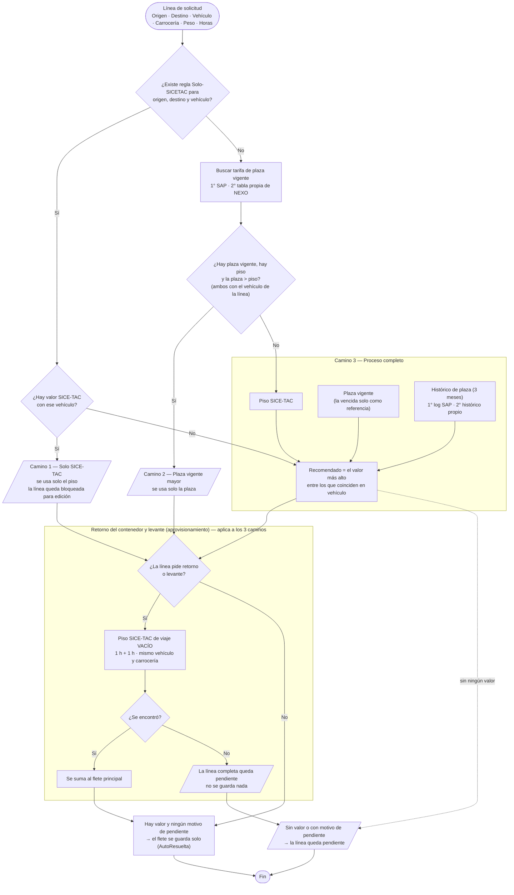

# Flujo de decisión de tarifa — NEXO

Cómo decide NEXO el flete de una línea de solicitud: qué fuentes consulta, en qué orden, cuándo guarda el valor solo y cuándo
deja la línea pendiente para el Administrador de Tarifas.

- **Base:** el diagrama `docs/documentacion/NEXO FLUJO.pdf`, con dos ajustes: el retorno del contenedor y el levante
  (aprovisionamiento) como tramos vacíos transversales, y la regla de que un valor con el vehículo relajado no gobierna solo.
- **Estado:** es el flujo que implementa el backend. La decisión vive en `clsReglaDeCosteo.DecidirFlujo` (Domain) y los datos los
  trae `clsPropuestaTarifaAdapter` (Infrastructure); los tres caminos de costeo (captura de la solicitud, costeo por línea en la cola y
  "Aplicar propuestas") usan el mismo cálculo.

---

## 1. Diagrama

---

## 2. Los tres caminos del flete principal

1. **Solo SICE-TAC.** La ruta con ese vehículo tiene regla Solo-SICETAC y existe valor SICE-TAC: se usa solo el piso (sin mirar plaza
   ni histórico) y la línea queda bloqueada para edición (`409 FLETE_SOLO_SICETAC`). Con regla pero sin valor SICE-TAC, pasa al proceso
   completo.
2. **Plaza vigente mayor.** Sin regla, con piso y con una plaza vigente estrictamente mayor que el piso: se usa solo la plaza y el
   histórico ni se consulta. La plaza se busca primero en SAP y, si ahí no hay una vigente, en la tabla propia de NEXO.
3. **Proceso completo.** Todo lo demás. Se comparan piso, plaza vigente (o la vencida solo como referencia) e histórico, y el
   recomendado es el valor más alto, con tres reglas que no cambian: nunca por debajo del piso SICE-TAC, una plaza vencida nunca se
   recomienda, y sin piso el histórico es solo referencia. Si ningún candidato deja un valor, la línea queda sin recomendado.

El flete se **guarda solo** cuando hay un valor propuesto y ningún motivo de pendiente, sea cual sea el camino (en la API,
`autocosteable` de cada línea de la propuesta). Sin valor, o con un motivo de pendiente, la línea queda pendiente y el
Administrador de Tarifas la resuelve en la Mesa. Un valor guardado por el proceso completo se puede cambiar después; el de Solo
SICE-TAC no.

Motivos de pendiente (`motivoPendiente`) que impiden guardar aunque haya un valor: línea de Cupo sin vehículo, período SICE-TAC que
no es el del mes actual, y retorno o levante sin piso del tramo vacío.

---

## 3. Retorno del contenedor y levante (aprovisionamiento)

Son costos aparte del flete principal y se calculan en el backend para los tres caminos:

- **Retorno del contenedor:** viaje vacío desde el destino de la línea hasta la ciudad de devolución.
- **Levante (aprovisionamiento):** viaje vacío desde la ciudad de levante hasta el origen de la línea.
- Siempre con SICE-TAC (nunca plaza ni histórico), condición de carga **VACÍO**, **1 h + 1 h**, el **mismo vehículo** y la **misma
  carrocería** de la línea. Cada ruta trae una fila por unidad de transporte con valores distintos: se elige la fila de la unidad de la
  carrocería, nunca la más barata. Sin carrocería solo se acepta en una línea de contenedor (unidad PORTACONTENEDORES). La
  carrocería se compara sin tildes ni mayúsculas.
- Los extremos se comparan por código DANE: el de la línea ya lo trae y el de la ciudad escrita a mano se resuelve por nombre; si la
  ciudad es ambigua, se busca por texto de la ruta.
- Si la línea pide un tramo y no hay piso exacto, la línea completa queda pendiente y no se guarda nada. Se suman al flete en la
  cotización (`valorAprovisionamiento`, `valorRetornoContenedor`); el valor que mande el cliente en `valorAprovisionamiento` se ignora.
- Una línea de **devolución de contenedor** no tiene retorno ni levante propios.

---

## 4. Reglas que aplican a todo el flujo

- **Horas por defecto del viaje cargado: 4 h + 4 h**, solo si el usuario no declara las suyas. Si las declara, mandan esas.
- **Devolución de contenedor:** el flete principal se busca con viaje **VACÍO** y **1 h + 1 h** por defecto (unidad PORTACONTENEDORES
  si no hay carrocería). La plaza SAP solo cuenta si coincide con la línea en consolidado, exclusivo y clase de contenedor.
- **Nunca un flete por debajo del piso SICE-TAC**, venga de plaza, histórico o de un valor manual: el servidor no lo guarda
  (`400 FLETE_BAJO_PISO_SICETAC`).
- **Vehículo relajado.** Si la línea pide un vehículo y la fuente no tiene tarifas de ese vehículo en la ruta, el valor se muestra con
  un aviso (`vehiculoRelajado` y `advertencia`) pero no entra al recomendado ni puede activar el camino 1 o el 2. Si todos los
  candidatos están relajados, no hay recomendado.
- La tabla propia de NEXO no tiene columnas de consolidado ni exclusivo; en una devolución de contenedor solo se le exige la clase de
  contenedor.

---

## 5. Tabla de casos del flete principal

Piso SICE-TAC de referencia: 2,5 M cuando existe. Todos los candidatos coinciden en vehículo.

| # | ¿Regla Solo-SICETAC? | Piso | Plaza | Histórico | Camino | Se guarda solo | Valor |
|---|---|---|---|---|---|---|---|
| 1 | Sí | 2,5 M | (no se mira) | (no se mira) | Solo SICE-TAC | Sí | 2,5 M — piso |
| 2 | Sí | — | 3,0 M vigente | 2,8 M | Proceso completo | Sí | 3,0 M — plaza |
| 3 | No | 2,5 M | 3,0 M vigente | 3,5 M | Plaza vigente mayor | Sí | 3,0 M — plaza |
| 4 | No | 2,5 M | 2,0 M vigente | 2,2 M | Proceso completo | Sí | 2,5 M — piso |
| 5 | No | 2,5 M | 3,0 M **vencida** | 2,8 M | Proceso completo | Sí | 2,8 M — histórico |
| 6 | No | 2,5 M | — | 2,8 M | Proceso completo | Sí | 2,8 M — histórico |
| 7 | No | 2,5 M | — | — | Proceso completo | Sí | 2,5 M — piso |
| 8 | No | — | 3,0 M vigente | — | Proceso completo | Sí | 3,0 M — plaza |
| 9 | No | — | — | 2,8 M | Proceso completo | **No** | sin recomendado (sin piso el histórico es referencia) |
| 10 | No | — | — | — | Proceso completo | **No** | sin recomendado |

---

## 6. Qué ve el Administrador de Tarifas en la Mesa

| Camino | Qué se muestra | ¿Puede elegir otro valor? |
|---|---|---|
| Solo SICE-TAC | Solo el piso, con el aviso "Ruta marcada Solo SICE-TAC". | No: es una regla. |
| Plaza vigente mayor | Piso y plaza, con el aviso "La plaza vigente supera el piso SICE-TAC". | No: ya está decidido. |
| Proceso completo | Los valores de cada fuente con el recomendado marcado; los de vehículo relajado, con su aviso. | Sí: otro de los valores, uno manual, o "Aplicar todas las propuestas". Nunca por debajo del piso. |

Cada valor dice de qué tabla salió: "Tarifario" / "Histórico SAP" cuando viene de SAP, y "Tarifario (NEXO)" / "Histórico (NEXO)" cuando
viene de las tablas propias. Una línea pendiente muestra su `motivoPendiente`.

---

## 7. Casos borde

- **Plaza vigente sin valor SICE-TAC:** proceso completo; la plaza se recomienda y se guarda (no hay piso con qué compararla).
- **Plaza igual al piso:** proceso completo (el camino 2 exige estrictamente mayor).
- **Plaza vigente en las dos tablas:** gana la de SAP, que es la primera en el orden.
- **El histórico propio empieza vacío:** solo se llena cuando se edita el valor, la vigencia o los detalles de una tarifa de plaza propia.
- **La fuente que se guarda no cambia:** un valor que viene de la tabla propia se guarda igual como "Tarifario" o "Histórica".
- **Pliegos grandes:** más de 10 líneas se costean en segundo plano con el mismo cálculo; el resultado es el mismo que al capturar.

---

## 8. Pruebas

- La decisión es una función pura (`clsReglaDeCosteo.DecidirFlujo`) y se prueba con candidatos armados a mano
  (`clsDecidirFlujoFinalTests`, `clsDecidirFlujoTests`): no dependen de la tarifa de ningún mes.
- La elección de la fila del tramo vacío se prueba con filas armadas a mano (`clsSeleccionSiceVacioTests`).
- `clsFlujoDeDecisionRealTests` corre escenarios de punta a punta contra el SICE-TAC y la base reales. Como la tarifa cambia cada mes,
  no afirma valores fijos sino relaciones que deben cumplirse con cualquier tarifa (el flete guardado es el propuesto, el total es la
  suma de sus partes, el tramo vacío sale de la unidad de la línea, un tramo sin piso deja la línea pendiente). Cada escenario se
  salta, diciendo por qué, si la ruta no existe en el SICE-TAC del entorno.
- Las pruebas contra la base real crean sus datos con la referencia `TEST-AUTO-…` y los borran al terminar, junto con las rutas y
  vehículos que crearon; además cada corrida barre los restos de una ejecución interrumpida. Ver `docs/pruebas/DATOS-DE-PRUEBA.md`.
