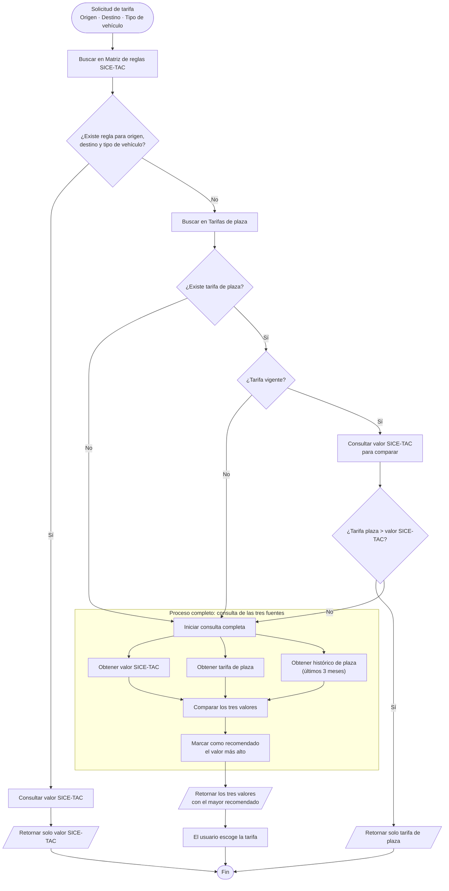
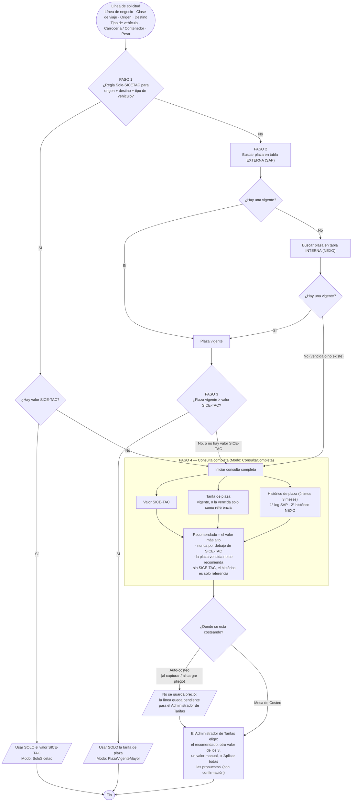

# Flujo de decisión de tarifa — NEXO

Cómo debe decidir NEXO el flete de una línea de solicitud: qué fuentes
consulta, en qué orden, cuándo resuelve solo y cuándo le deja la
decisión al Administrador de Tarifas.

- **Base:** el diagrama `docs/documentacion/NEXO FLUJO.pdf`.
- **Ajustes:** confirmados con negocio (Sara) el 2026-10-12, punto por
  punto.
- **Estado:** es el flujo **objetivo**. El código actual **no** lo
  cumple todavía — las diferencias están en la sección 7 y las HU para
  implementarlo en la sección 11.
- **Aplica a:** todo cálculo de propuesta de flete — el auto-costeo al
  capturar una solicitud, el auto-costeo al cargar un pliego, y la
  "Propuesta de la Biblioteca" que ve el Administrador de Tarifas en
  Mesa de Costeo. Los tres pasan por el mismo método del backend
  (`clsPropuestaTarifaAdapter.ProponerLineaAsync`).

---

## 1. Diagrama original (`NEXO FLUJO.pdf`)

Reproducción fiel del PDF:

---

## 2. Qué se ajustó sobre el diagrama original

El diagrama del PDF se mantiene; estos son los ajustes que confirmó
negocio:

1. **Regla Solo-SICETAC sin valor SICE-TAC.** El PDF no dice qué pasa
   si la ruta tiene regla pero no hay valor en la tabla de SICE-TAC
   (`tblRutasSicetac`). Se define: **pasa a la consulta completa**.
2. **La tarifa de plaza se busca en 2 tablas, en orden:**
   1. la externa de SAP (`tblSAPTarifas`);
   2. si ahí no hay una vigente, la propia de NEXO (`tbl_tarifas_plaza`,
      la que se gestiona en Biblioteca → Tarifas de plaza).

   Si la externa solo tiene una vencida y la interna tiene una vigente,
   **gana la interna vigente.**
3. **El histórico de plaza también se busca en 2 tablas, en orden:**
   1. el log de SAP (`tblSAPTarifasLog`);
   2. si ahí no hay nada, el histórico propio de NEXO
      (`tbl_tarifas_plaza_historico`).
4. **En la consulta completa, "el usuario escoge la tarifa" se respeta
   siempre.** El auto-costeo (al capturar o al cargar un pliego) **no
   guarda ningún precio** en esos casos: la línea queda pendiente y el
   Administrador de Tarifas la decide en Mesa de Costeo. Solo se
   costean solas las líneas que el diagrama resuelve sin preguntar
   (regla Solo-SICETAC con valor, y plaza vigente mayor que el
   SICE-TAC).
5. **Para no ir línea por línea**, el Administrador de Tarifas tiene el
   botón **"Aplicar todas las propuestas"**, que aplica el valor
   recomendado a todas las líneas pendientes **después de confirmar**.

---

## 3. Diagrama del flujo objetivo (con los ajustes)

---

## 4. El flujo, paso a paso

**Entrada:** una línea de solicitud con línea de negocio, clase de
viaje, origen, destino, tipo de vehículo, carrocería o contenedor, peso
y horas de cargue/descargue.

### Paso 1 — Regla Solo-SICETAC

Se revisa si la combinación **origen + destino + tipo de vehículo**
tiene una regla en Reglas Solo-SICETAC.

- **Hay regla y hay valor SICE-TAC** → se usa **solo** ese valor. No se
  compara contra nada más y no se muestran otras opciones. Queda
  resuelto (**modo `SoloSicetac`**). Fin.
- **Hay regla pero no hay valor SICE-TAC** → no se queda sin nada: pasa
  a la **consulta completa** (Paso 4).
- **No hay regla** → Paso 2.

### Paso 2 — Buscar la tarifa de plaza (2 tablas)

1. Se busca en la tabla **externa** (SAP).
2. Si ahí no hay una **vigente**, se busca en la tabla **interna** de
   NEXO.

- Si aparece una **vigente** (en cualquiera de las 2) → Paso 3.
- Si no aparece ninguna vigente (solo vencidas, o nada) → **consulta
  completa** (Paso 4). Si había una vencida, se muestra en la consulta
  completa solo como referencia.

### Paso 3 — ¿La plaza vigente supera el valor SICE-TAC?

- **Sí** (estrictamente mayor) → se usa **solo** la tarifa de plaza. No
  se consulta el histórico y no se muestran otras opciones (**modo
  `PlazaVigenteMayor`**). Fin.
- **No** (es menor o igual), **o** no hay valor SICE-TAC con qué
  compararla → **consulta completa** (Paso 4).

### Paso 4 — Consulta completa

Se traen los 3 valores:

| Valor | De dónde sale |
|---|---|
| SICE-TAC | `tblRutasSicetac` |
| Tarifa de plaza | La vigente si hay; si no, la vencida (marcada como referencia). Externa primero, interna después. |
| Histórico de plaza | Últimos 3 meses. Primero el log de SAP; si ahí no hay nada, el histórico de NEXO. |

Se marca como **recomendado el valor más alto**, con 3 reglas que no
cambian:

- Nunca se recomienda un valor por debajo del SICE-TAC (cotizar bajo el
  piso legal es sanción).
- Una tarifa de plaza vencida nunca se recomienda.
- Sin valor SICE-TAC, el histórico no se recomienda: queda solo como
  referencia para que una persona decida.

**Qué pasa después:**

- **En el auto-costeo** (al capturar la solicitud o al cargar un
  pliego) **no se guarda ningún precio**: la línea queda pendiente,
  con el recomendado calculado pero sin aplicar.
- **En Mesa de Costeo**, el Administrador de Tarifas ve los 3 valores
  con el recomendado marcado y **tiene la última palabra**: usa el
  recomendado, elige otro de los 3 con un clic, o escribe un valor
  manual. Si son muchas líneas, puede usar **"Aplicar todas las
  propuestas"**, que aplica el recomendado a todas las pendientes
  después de confirmar.

Las únicas líneas que llegan a Mesa de Costeo ya con precio son las
que se resolvieron solas en el Paso 1 (regla Solo-SICETAC con valor) o
en el Paso 3 (plaza vigente mayor que el SICE-TAC).

---

## 5. Tabla de casos

Valor SICE-TAC = 2.500.000 en los casos que lo tienen. "—" = no hay.

| # | ¿Regla Solo-SICETAC? | SICE-TAC | Plaza | Histórico | Modo | En el auto-costeo | Recomendado que ve el Administrador |
|---|---|---|---|---|---|---|---|
| 1 | Sí | 2,5 M | (no se mira) | (no se mira) | SoloSicetac | **Guarda 2,5 M** — SICE-TAC | — |
| 2 | Sí | — | 3,0 M vigente | 2,8 M | ConsultaCompleta | Queda pendiente | 3,0 M — plaza (sin SICE-TAC, la plaza gobierna sola) |
| 3 | No | 2,5 M | 3,0 M vigente | 3,5 M | PlazaVigenteMayor | **Guarda 3,0 M** — plaza (el histórico no se mira) | — |
| 4 | No | 2,5 M | 2,0 M vigente | 2,2 M | ConsultaCompleta | Queda pendiente | 2,5 M — SICE-TAC (plaza e histórico están por debajo: no se pueden usar) |
| 5 | No | 2,5 M | 3,0 M **vencida** | 2,8 M | ConsultaCompleta | Queda pendiente | 2,8 M — histórico (la vencida no se recomienda) |
| 6 | No | 2,5 M | — | 2,8 M | ConsultaCompleta | Queda pendiente | 2,8 M — histórico |
| 7 | No | 2,5 M | — | — | ConsultaCompleta | Queda pendiente | 2,5 M — SICE-TAC (único valor) |
| 8 | No | — | 3,0 M vigente | — | ConsultaCompleta | Queda pendiente | 3,0 M — plaza (sin SICE-TAC, la plaza gobierna sola) |
| 9 | No | — | — | 2,8 M | ConsultaCompleta | Queda pendiente | **Sin recomendado** (sin SICE-TAC, el histórico es solo referencia) |
| 10 | No | — | — | — | ConsultaCompleta | Queda pendiente | **Sin recomendado** (el Administrador escribe un valor manual) |

**Ojo con el caso 7:** aunque solo haya un valor (el SICE-TAC), la línea
también queda pendiente, porque sin plaza el diagrama manda a la
consulta completa. Como en el ambiente de pruebas la mayoría de rutas
no tienen plaza, van a llegar muchas líneas pendientes — "Aplicar todas
las propuestas" las resuelve de una vez.

**El caso 3 es el cambio de comportamiento más importante:** hoy el
sistema elegiría el histórico (3,5 M) porque es el más alto de todos.
Con este flujo, una plaza vigente que supera el SICE-TAC gobierna sola
y el histórico ni se consulta.

---

## 6. Qué ve el Administrador de Tarifas en Mesa de Costeo

La "Propuesta de la Biblioteca" muestra en qué modo se decidió:

| Modo | Qué se muestra | ¿Puede elegir otro valor? |
|---|---|---|
| SoloSicetac | Solo el valor SICE-TAC, con el aviso "Ruta marcada Solo SICE-TAC". | No — es una regla. |
| PlazaVigenteMayor | SICE-TAC y la plaza, con el aviso "La plaza vigente supera el SICE-TAC". | No — ya está decidido. |
| ConsultaCompleta | Los 3 valores, el recomendado marcado. La línea llega **sin precio**. | **Sí**: botón "Usar este" en cada valor (menos en una plaza vencida o en un valor por debajo del SICE-TAC), valor manual, o "Aplicar todas las propuestas" para todas las pendientes (con confirmación). |

Además, cada valor dice de qué tabla salió: "Tarifario" / "Histórico
SAP" cuando viene de SAP, y **"Tarifario (NEXO)"** / **"Histórico
(NEXO)"** cuando viene de las tablas propias de NEXO.

**Regla que no tiene excepción: nunca un valor por debajo del
SICE-TAC.** El Administrador de Tarifas no puede guardar un flete por
debajo del SICE-TAC de la línea, venga de tarifario, histórico o lo
escriba a mano. El sistema **no lo deja guardar** y le muestra un aviso
explicando por qué (no es una confirmación que se pueda aceptar). Por
eso, en la consulta completa, un valor por debajo del SICE-TAC aparece
marcado "Por debajo del piso SICE-TAC — no se puede usar" y no tiene
botón "Usar este". El servidor también lo valida, para que no se pueda
saltar.

El rol Comercial no ve esta propuesta (no tiene el permiso). Cuando
abre Mesa de Costeo, el sistema aplica solas únicamente las líneas
que se resuelven sin preguntar (Solo-SICETAC y plaza vigente mayor);
las de consulta completa se quedan sin precio, esperando al
Administrador de Tarifas.

---

## 7. Diferencias con el sistema actual

| Punto | Hoy | Con este flujo |
|---|---|---|
| Regla Solo-SICETAC sin valor SICE-TAC | Se queda en "requiere atención manual"; ni siquiera busca plaza ni histórico. | Consulta completa. |
| Plaza vigente que supera el SICE-TAC | Compite también contra el histórico; si el histórico es más alto, gana el histórico. | Gana la plaza sola. |
| De dónde sale la plaza | Solo de SAP. La tabla de NEXO (Biblioteca → Tarifas de plaza) **nunca se consulta**. | SAP y, si no hay vigente, NEXO. |
| Plaza de SAP vencida | Si el camino principal de SAP encuentra una vencida, no busca una vigente por otro lado. | Sigue buscando una vigente (en SAP y en NEXO) antes de quedarse con la vencida. |
| De dónde sale el histórico | Solo del log de SAP. El histórico de NEXO ni siquiera se puede consultar hoy. | Log de SAP y, si no hay, histórico de NEXO. |
| Elegir otro valor en Mesa de Costeo | Solo se puede aceptar el recomendado ("Usar propuesta") o reescribir el valor a mano. | Botón "Usar este" en cada valor, solo en consulta completa. |
| Guardar un valor por debajo del SICE-TAC | Se puede. Solo hay un aviso de "confirmar de todas formas" para valores manuales. | Bloqueado para cualquier fuente, en pantalla y en el servidor. |
| Auto-costeo en consulta completa | Aplica el más alto y la línea queda autocosteada. | **No guarda precio**: la línea queda pendiente para el Administrador de Tarifas. |
| Al abrir Mesa de Costeo, el Comercial | Aplica en silencio todas las propuestas. | Solo aplica las de Solo-SICETAC y plaza vigente mayor. |
| "Iniciar costeo" | Parece que aplica todo de una vez: en realidad muestra la cotización que el auto-costeo ya había llenado al capturar (la pantalla no la mostraba antes del clic). | Ya no llega precio en consulta completa, y la pantalla muestra la cotización al abrir, sin depender del clic. |
| Botón "Aplicar propuestas" | Aplica de una, sin confirmar. | Se llama "Aplicar todas las propuestas" y pide confirmación. |
| Métrica "% líneas auto-costeadas" (Tablero) | Cuenta también las de consulta completa. | Va a bajar: esas líneas ya no se auto-costean. |

---

## 8. Casos borde ya definidos

- **Plaza vigente sin valor SICE-TAC** → consulta completa: no se puede
  comprobar que sea "mayor". La plaza sale como recomendada, pero la
  línea queda pendiente para que el Administrador la confirme.
- **Plaza igual al SICE-TAC** → consulta completa (el PDF dice "mayor").
- **Plaza vigente en las 2 tablas** → gana la de SAP (es la primera en
  el orden).
- **Plaza vencida en las 2 tablas** → se muestra como referencia la de
  SAP.
- **El histórico de NEXO empieza vacío:** solo se llena cuando alguien
  edita el valor, la vigencia o los detalles de una tarifa de plaza de
  NEXO (también al reimportar por Excel una que ya existía). Al
  principio casi nunca va a aportar valor.
- **La fuente que se guarda no cambia:** un valor que viene de la tabla
  de NEXO se guarda igual como "Tarifario" o "Histórica". La tabla de
  origen solo se muestra como etiqueta.

---

## 9. Fuera del alcance de este flujo (pendientes aparte)

Encontrados en la misma revisión, sin decisión todavía:

- **El cruce de ciudades contra la plaza de SAP es frágil:** existe un
  traductor de zonas ya probado (`clsResolucionZonaSap`, 577 zonas
  reales) que no está conectado al cruce de la plaza — **se decidió
  conectarlo** (HU-B22).
- **En el ambiente de pruebas, la plaza de SAP solo tiene Contenedor**
  (107 filas): para Cupo, Carga Suelta y Extradimensionado nunca
  encuentra plaza en SAP. Con este flujo, la tabla de NEXO sí podría
  cubrirlos.
- **QA "Desviación 1":** en 4 de 12 líneas reales había una plaza
  vigente hasta 3,9 veces mayor que el SICE-TAC y no se propuso. Causa
  sin confirmar — **se decidió investigarla** (HU-B19).
- **Los 2 caminos de auto-costeo no dejan la línea igual** (en los casos
  que se resuelven solos): al capturar, el flete queda en la cotización
  en el momento; al cargar un pliego, la línea queda autocosteada pero
  el flete llega después, cuando alguien aplica las propuestas. Queda
  como recomendación igualarlos; mientras tanto, "Aplicar todas las
  propuestas" las llena de una vez.

---

## 10. Pendientes de decisión

1. ~~Guardar el valor del histórico desde Mesa de Costeo~~ (HU-B17) —
   **decidido: opción A**, el servidor acepta el valor si coincide con
   el histórico que propuso el sistema para esa línea.
2. ~~Confirmación al elegir un valor por debajo del SICE-TAC~~ —
   **decidido:** no es una confirmación, es un bloqueo para cualquier
   fuente (ver sección 6).

---

## 11. Referencias

- Especificación técnica completa (archivo y línea de cada cambio,
  pruebas, orden de implementación): `docs/2026-10-09_HU-BACKEND.md`, sección
  **"Motor de decisión de tarifa"**.
  - **HU-B14** — plaza en 2 tablas (SAP → NEXO).
  - **HU-B15** — histórico en 2 tablas (incluye poder consultar
    `tbl_tarifas_plaza_historico`, que hoy no se puede).
  - **HU-B16** — nuevo orden de decisión y campo `ModoDecision`.
  - **HU-B17** — poder guardar el histórico de la propuesta.
  - **HU-B18** — nunca guardar un flete por debajo del SICE-TAC
    (validación en el servidor).
  - **HU-B19** — investigar la "Desviación 1" de QA.
  - **HU-B22** — conectar el traductor de zonas al buscar la plaza en
    SAP.
- Parte de pantalla: `docs/2026-10-09_HU-FRONTEND.md`, sección Mesa de Costeo:
  **HU-16** (propuesta según el modo, "Usar este"), **HU-17** (bloqueo
  y aviso por debajo del SICE-TAC) y **HU-19** ("Aplicar todas las
  propuestas" con confirmación).
- Relacionado: **HU-9 / HU-B7** — que Mesa de Costeo muestre la
  cotización existente al abrir (hoy solo aparece después de "Iniciar
  costeo", y eso hacía parecer que el botón aplicaba todo).
- Diagrama original: `docs/documentacion/NEXO FLUJO.pdf`.
- Reglas de negocio generales: `docs/documentacion/MAPA-FUNCIONAL-NEXO.md`,
  sección 6.
- Orden sugerido: HU-B15 y HU-B14 → HU-B16 → HU-B17 → HU-16.
