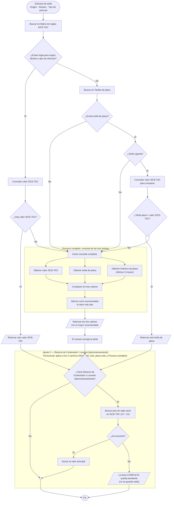

# Flujo final NEXO

Parte del diagrama original (`docs/documentacion/NEXO FLUJO.pdf`) y le aplica solo los ajustes que se definieron en esta conversación.

**Estado (2026-10-21):** este es el flujo que manda de aquí en adelante. El backend desplegado hoy no lo cumple todavía — las diferencias quedaron documentadas en `2026-10-21_RESULTADO-PRUEBAS-NEXO-DEPLOY.md` (casos 2, 4, 5, 6 y 8 del QA). Hay que ajustar `clsReglaDeCosteo.DecidirFlujo` para que el backend siga este documento.

---

## Diagrama con los 2 ajustes

---

## Notas adicionales

- **Retorno de Contenedor y Levante (Aprovisionamiento) siempre se calculan con SICE-TAC** — nunca con tarifa de plaza ni histórico. Tiempos logísticos **1h + 1h** (no las horas del tramo cargado). Se busca con **viaje VACÍO, nunca CARGADO**. Mismo tipo de vehículo y misma carrocería que la línea principal.
- **Cuando la línea es de Devolución de Contenedor**, al buscar en SICE-TAC para el valor principal (no el de un tramo adicional, sino el de la línea misma) también se busca con **viaje VACÍO**, y con tiempos logísticos **1h + 1h**.
- **Horas por defecto en los viajes cargados: 4h + 4h.** Aplica solo si el usuario **no** ingresa sus propias horas de cargue y descargue — si las declara, esas horas mandan y el default no aplica. Esto es para las líneas que no sean Devolución de Contenedor (esas siguen siendo 1h+1h, según la nota anterior).
- **Nunca se guarda un flete por debajo del piso SICE-TAC.** Ni el recomendado del Proceso completo, ni un valor manual del Administrador de Tarifas, pueden quedar por debajo del valor SICE-TAC de esa línea.
- **Las líneas resueltas por regla Solo-SICETAC quedan bloqueadas para edición.** El Administrador de Tarifas no puede cambiarles el valor después.
- **El nivel tolerante sigue existiendo** (si el vehículo exacto deja 0 filas, se relaja el filtro — línea de negocio → clase de viaje → clase de contenedor → vehículo → peso — hasta quedar con lo que haya, en SICE-TAC, en plaza o en histórico). Pero **una fuente que ganó con el vehículo relajado no puede ganar sola**: no puede disparar Solo-SICETAC ni Plaza-estrictamente-mayor. Solo puede aparecer como candidato dentro del Proceso completo, marcado con un aviso de que no coincide en vehículo.
- **Si en el Proceso completo no aparece ningún valor** (ni SICE-TAC, ni plaza, ni histórico), la línea queda **sin recomendado**, pendiente para que el Administrador de Tarifas escriba un valor manual.
- **Devolución de Contenedor no tiene su propio Retorno/Levante.** La línea misma ya ES la devolución — el Ajuste 2 (Retorno de Contenedor / Levante) no le aplica como tramo adicional.
- **En Devolución de Contenedor, la tarifa de plaza se filtra por Consolidado, Exclusivo y clase de contenedor.** Una fila de plaza que no coincida en esos 3 campos con la línea no cuenta como candidato, aunque esté vigente.

---

## Respuestas a las sugerencias

1. **¿Cuál flujo manda?** **Este documento.** Hay que ajustar `clsReglaDeCosteo.DecidirFlujo` para que el backend lo siga; mientras tanto, los ejemplos 2, 4, 5, 6 y 8 del documento de ejemplos spot son el comportamiento correcto a implementar, no un error del documento.

2. **¿Se sube el aprovisionamiento al backend?** **Sí.** Ya quedó decidido en el Ajuste 2 (transversal) de este mismo flujo: la propuesta tiene que calcular el Retorno/Levante ella misma (no esperar a que el front lo mande), devolverlo como parte de la respuesta, y dejar la línea COMPLETA pendiente si no encuentra el piso del tramo vacío. No es una sugerencia aparte — es consecuencia directa de este documento.

3. **¿Cómo se elige la fila del tramo vacío?** **Por carrocería/unidad de transporte igual a la línea principal, nunca "la más barata".** Ya está en las Notas adicionales (nota 1: "Mismo tipo de vehículo y misma carrocería que la línea principal").

4. **¿Se corrige la devolución de contenedor como lo pide el QA?** **Sí, completo.** Condición VACÍO para el flete principal (ya estaba), y ahora también filtrar la plaza por Consolidado, Exclusivo y clase de contenedor (se agregó a las notas) — una plaza que no coincida en esos 3 campos no cuenta como candidato, aunque esté vigente.

5. **¿Se avisa cuando se relaja el vehículo?** **Sí.** El nivel tolerante se mantiene (sigue relajando hasta quedarse con lo que haya), pero una fuente que ganó con el vehículo relajado no puede ganar sola — solo entra como candidato al Proceso completo, marcado con el aviso.

6. **¿Convertir el documento de ejemplos en pruebas automáticas?** Queda a decisión de Ismael.

7. **¿Plan para la cuarentena de vehículos?** Punto abierto: si Nexo siempre envía el código ya resuelto (`2S2`, `2S3`, `3S3`, etc.) y nunca texto libre, no debería hacer falta un alias para que un código válido se reconozca — la cuarentena debería ser solo para texto que de verdad no se reconoce. Que `2S3` caiga en cuarentena aun enviándose como código sugiere que el chequeo de cuarentena no está comparando contra el catálogo completo de vehículos, solo contra la tabla de alias. Vale la pena confirmarlo con Ismael, aparte de este documento.

8. **¿Limpieza de datos de prueba `TEST-QA-IA`?** Queda a decisión de Ismael.
