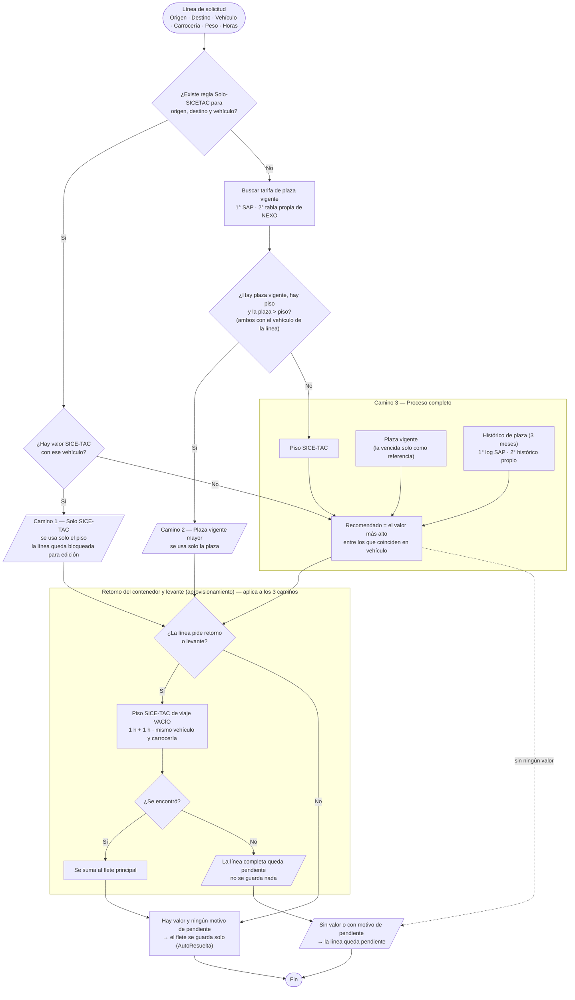

# Funcionamiento de NEXO

Cómo funciona NEXO (Cabina de Fletes) de punta a punta: quién entra y con qué permisos, qué hace cada pantalla y con qué
reglas se captura una solicitud, se decide el flete, se arma la cotización y se entrega. Está verificado contra el código
del backend y del front (módulo `cabina-fletes` del portal de la Administración) al 2026-11-10.

Para el detalle técnico de cada endpoint (request, respuesta y errores) ver [`CONTRATO.md`](../../CONTRATO.md). Para la
integración con el portal (identidad, trabajos pesados y avisos en vivo) ver
[`docs/contrato-integracion/`](../contrato-integracion/). Las decisiones técnicas están en
[`docs/decisiones/DECISIONES-NEXO.md`](../decisiones/DECISIONES-NEXO.md). El documento original de negocio es
[`Entendimiento_Nexo(vision desde desarrollo).docx`](<Entendimiento_Nexo(vision desde desarrollo).docx>), en esta misma carpeta.

## Contenido

1. [Qué es NEXO](#1-qué-es-nexo)
2. [Acceso, roles y permisos](#2-acceso-roles-y-permisos)
3. [Recorrido de una solicitud](#3-recorrido-de-una-solicitud)
4. [Captura](#4-captura)
5. [Bandeja y priorización](#5-bandeja-y-priorización)
6. [Costeo: cómo se decide el flete](#6-costeo-cómo-se-decide-el-flete)
7. [Mesa de Costeo y cotización](#7-mesa-de-costeo-y-cotización)
8. [Vehículos, alias y normalización](#8-vehículos-alias-y-normalización)
9. [Biblioteca y tarifas](#9-biblioteca-y-tarifas)
10. [Cubicación y planes de cargue](#10-cubicación-y-planes-de-cargue)
11. [Asistente de cotización](#11-asistente-de-cotización)
12. [Tablero y métricas](#12-tablero-y-métricas)
13. [Notificaciones](#13-notificaciones)
14. [Diferencias entre lo que muestra el front y lo que permite el backend](#14-diferencias-entre-lo-que-muestra-el-front-y-lo-que-permite-el-backend)

---

## 1. Qué es NEXO

NEXO reemplaza el costeo manual de fletes (cruzar a mano SICE-TAC, SAP y Excel) por un sistema que propone el flete de
cada línea de una solicitud, respetando el piso legal SICE-TAC y la tarifa de plaza. Además recomienda el vehículo según la
carga (cubicación), agrega los servicios conexos y arma la cotización que se entrega al comercial. Todo cambio queda
auditado.

| Término | Significado |
|---|---|
| Solicitud | Pedido de cotización de un cliente: una o varias líneas. Puede ser Spot (puntual) o Licitación (pliego). |
| Línea | Un viaje: origen, destino, vehículo, carrocería, peso, clase de viaje y línea de negocio. |
| Piso SICE-TAC | Valor mínimo legal del flete para una ruta y configuración vehicular, del mes actual. |
| Plaza | Tarifa de mercado: la de SAP o la propia de NEXO. |
| Histórico de plaza | Tarifas de plaza de los últimos 3 meses. |
| Cotización | El resultado del costeo de una solicitud: fletes por línea, servicios conexos y total. |
| Servicio conexo | Servicio adicional al flete (almacenamiento, ITR, acompañamiento, barra satelital…). |

---

## 2. Acceso, roles y permisos

### Cómo se entra

NEXO no tiene login propio. La persona entra desde el portal de la Administración, que exige un permiso cuya opción
termine en «NEXO». En cada petición el front envía el identificador del usuario del portal y el backend:

1. busca a la persona en la tabla de usuarios del portal;
2. lee sus roles del portal y los traduce a un rol de NEXO con `tbl_mapeo_rol_portal`;
3. crea o actualiza su usuario en NEXO con ese rol.

No hay caché de sesión: un cambio de rol en el portal se nota en la siguiente petición. Sin identidad válida la respuesta es
`401 SESION_INVALIDA`; con identidad pero sin rol de NEXO, `403 SIN_PERMISO_CABINA_FLETES`. Si una persona tiene varios
roles, gana el de mayor precedencia: Admin > AdminTarifas > AdminBiblioteca > Comercial > LiderProceso >
ServiciosLogisticos. Ese orden está pendiente de confirmar por negocio.

| Rol del portal | Rol de NEXO |
|---|---|
| `TarifasComercial`, `ComercialNEXO` | Comercial |
| `TarifasAdministrador`, `AdminTarifasNEXO` | AdminTarifas |
| `Administracion`, `AdminNEXO` | Admin |
| `CoordinadorFletesNEXO` | AdminBiblioteca |
| `ServiciosLogisticosNEXO` | ServiciosLogisticos |
| `LiderProcesoNEXO` | LiderProceso |

### Los seis roles

| Rol | Para qué es | Pantalla de inicio |
|---|---|---|
| **Comercial** | Captura solicitudes, agrega servicios conexos a sus cotizaciones y cancela pliegos. Solo ve sus propias solicitudes. | Bandeja |
| **AdminTarifas** | Opera el costeo del día a día: Mesa de Costeo, fletes, entrega de cotizaciones, Biblioteca, tarifas de plaza, reglas Solo SICE-TAC, Cubicador, normalización de vehículos, diccionario de clientes y asistente. | Bandeja |
| **Admin** | Todo lo anterior, más la priorización, marcar cotizaciones ganadas o perdidas, borrar vehículos del catálogo y ver el gasto de la IA. | Bandeja |
| **AdminBiblioteca** | Mantiene la Biblioteca: tarifas de plaza, vigencias, reglas Solo SICE-TAC y diccionario de clientes. No entra a Bandeja, Mesa ni cotizaciones. | Biblioteca |
| **ServiciosLogisticos** | Mantiene el catálogo de servicios conexos. | Biblioteca |
| **LiderProceso** | Consulta el Tablero de métricas. | Tablero |

Comercial, AdminTarifas, Admin y AdminBiblioteca son los que se asignan hoy a usuarios reales. ServiciosLogisticos y
LiderProceso existen en el sistema con sus permisos, pero no se asignan.

### Qué ve cada rol

El front decide qué pantallas y botones muestra con su propia tabla de permisos. El backend vuelve a validar cada
operación, así que ocultar un botón es solo una ayuda visual. La sección 14 lista los casos en que los dos no coinciden.

| Pantalla o acción | Comercial | AdminTarifas | Admin | AdminBiblioteca | ServiciosLogisticos | LiderProceso |
|---|:---:|:---:|:---:|:---:|:---:|:---:|
| Bandeja | ✅ (solo las suyas) | ✅ | ✅ | — | — | — |
| Captura (nueva solicitud) | ✅ | — | ✅ | — | — | — |
| Mesa de Costeo: ver la propuesta y agregar o editar fletes | — | ✅ | ✅ | — | — | — |
| Mesa de Costeo: rechazar línea y cambiar vehículo | — | ✅ | ✅ | — | — | — |
| Mesa de Costeo: aplicar todas las propuestas | — | ✅ | ✅ | — | — | — |
| Agregar servicios conexos a la cotización | ✅ | Solo ver | ✅ | — | — | — |
| Entregar la cotización al comercial | — | ✅ | ✅ | — | — | — |
| Marcar ganada o perdida | — | — | ✅ | — | — | — |
| Cancelar pliego | ✅ | — | ✅ | — | — | — |
| Biblioteca (consultar) | — | ✅ | ✅ | ✅ | ✅ | ✅ |
| Ajustar vigencia de plaza | — | ✅ | ✅ | ✅ | — | — |
| Catálogo de servicios conexos (crear, editar, importar) | — | ✅ | ✅ | — | ✅ | — |
| Tarifas de plaza | — | ✅ | ✅ | ✅ | — | — |
| Reglas Solo SICE-TAC | — | ✅ | ✅ | ✅ | — | — |
| Diccionario de clientes | — | ✅ | ✅ | ✅ | — | — |
| Cubicador (planes de cargue) | — | ✅ | ✅ | — | — | — |
| Catálogos del Cubicador y normalización de vehículos | — | ✅ (edita) | ✅ (edita) | — | Solo ver | Solo ver |
| Asistente de cotización | — | ✅ | ✅ | — | — | — |
| Tablero | — | ✅ | ✅ | — | — | ✅ |
| Priorización y gasto de la IA | — | — | ✅ | — | — | — |

---

## 3. Recorrido de una solicitud

1. **Comercial** crea la solicitud en **Captura**, a mano o importando el Excel del cliente.
2. NEXO **costea solo** cada línea: hasta 10 líneas en la misma petición; con más, en segundo plano. Las líneas que tienen
   un valor claro quedan resueltas y las demás quedan pendientes con su motivo.
3. La solicitud entra a la **Bandeja**, ordenada por puntaje de prioridad.
4. **AdminTarifas** abre la **Mesa de Costeo**: revisa la propuesta de cada línea, resuelve las pendientes (usa una
   propuesta, escribe un valor, cambia el vehículo o rechaza la línea) y puede cubicar una línea o consultar al asistente.
5. **Comercial** agrega los **servicios conexos** que correspondan.
6. **AdminTarifas** **entrega** la cotización: el comercial que creó la solicitud recibe un correo con el PDF.
7. **Admin** marca la cotización como **ganada** o **perdida**. Una ganada guarda sus fletes como tarifas históricas.
8. **AdminTarifas** y **LiderProceso** siguen el cumplimiento en el **Tablero**.

### Estados

| Qué | Estados |
|---|---|
| Solicitud | `Pendiente` → `EnCosteo` (al abrirla en la Mesa) → `Entregada` o `Descartada`. Entregada y Descartada son finales. |
| Línea | `PorCostear`, `AutoResuelta` (costeada sola), `Revisada` (flete puesto por una persona), `Rechazada`. |
| Cotización | `Borrador` → `Entregada`. Resultado: `SinDefinir` → `Ganada` o `Perdida` (se fija una sola vez). |

---

## 4. Captura

### Datos de la solicitud

Cliente (búsqueda por nombre o NIT, obligatorio), tipo (Spot o Licitación), fecha límite (obligatoria, no anterior a hoy)
y notas. Una licitación se captura siempre desde Excel. El borrador se guarda en el navegador y se recupera al volver.

### Solicitud puntual

Formulario línea por línea. Por cada línea se puede cubicar la mercancía (recomendación de vehículo, sección 10), estimar
el aprovisionamiento e importar una lista de empaque desde Excel.

### Importar Excel

Se elige primero el cliente. El archivo (`.xlsx` o `.xlsm`) pasa por cinco pasos:

1. **Hojas.** Se eligen las hojas que traen rutas. La línea de negocio se puede deducir del nombre de la hoja (impo, expo,
   nacional).
2. **Ajuste del formato.** NEXO lee la estructura del archivo: dónde empieza la tabla, qué filas son encabezados, qué
   columnas forman una matriz. Si el cliente ya tiene un formato guardado, lo reutiliza sin IA. Si el formato cambió, usa
   la IA, y la persona puede corregir la lectura escribiendo una instrucción.
3. **Mapeo de columnas.** Qué columna corresponde a cada campo de NEXO (origen y destino son obligatorios). Primero se usa
   una plantilla guardada del cliente; luego su diccionario de términos; lo que falte lo sugiere la IA. También se puede
   mapear a mano.
4. **Precio.** Conservar el precio que trae el archivo (esas rutas no se costean) o costear todo.
5. **Vista previa y carga.** Edición de celdas, asignación en bloque por rango de filas, borrar o restaurar rutas. Los
   campos obligatorios que faltan se marcan en rojo y bloquean la creación.

En la vista previa, los textos de vehículo, carrocería y ciudad se **normalizan**: primero con reglas exactas (diccionario
del cliente, alias, catálogo oficial, sinónimos, código DANE o nombre del municipio) y, para lo que quede, con una sola
consulta a la IA sobre listas cerradas. La persona confirma cada valor y puede marcarlo «Recordar», lo que lo guarda en el
diccionario del cliente. Al final NEXO pregunta en una sola ventana si guardar el formato de lectura, la plantilla de mapeo
y los valores recordados, para que el siguiente Excel del mismo cliente se lea sin IA.

**Sin IA la importación sigue funcionando** con las reglas: plantilla, diccionario, alias, catálogos y DANE. La IA solo
completa lo que las reglas no resuelven, y nunca recibe datos de nivel A de la decisión D-10 (NIT, nombres, valores
comerciales…).

### Reglas de captura por línea de negocio y clase de viaje

Líneas de negocio visibles: Devolución de contenedor, Interior a puerto, Puerto a interior y Nacional. Clases de viaje:
Carga suelta, Contenedor, Cupo y Extradimensionado.

| | Siempre |
|---|---|
| Obligatorios | Línea de negocio, origen, destino, clase de viaje, peso (mayor que 0, o la suma de las posiciones), horas de cargue y descargue (0 a 240) |
| Opcionales | Valor de la mercancía, carrocería |

| Clase de viaje | Qué cambia |
|---|---|
| **Contenedor** | Clase de contenedor obligatoria (`CNT20.IT`, `CNT20.RE`, `CNT20.ST`, `CNT40.HC`, `CNT40.RE`). No se elige vehículo: NEXO lo escoge por clase de contenedor y peso (sección 8). Carrocería fija PORTACONTENEDORES. Casillas Exclusivo y Consolidado. |
| **Carga suelta, Cupo, Extradimensionado** | Configuración de vehículo obligatoria. Casillas Consolidado y «Retorna contenedor» (si se marca, la ciudad de devolución es obligatoria). Las posiciones y la lista de empaque solo aplican a Carga suelta y Extradimensionado. |

| Línea de negocio | Qué cambia |
|---|---|
| **Devolución de contenedor** | Clase de viaje fija en Contenedor. Sin valor de mercancía. Peso por clase de contenedor (40' = 4.000 kg, 20' = 2.300 kg). Horas fijas en 1 + 1. |
| **Nacional** | No ofrece Contenedor como clase de viaje ni PORTACONTENEDORES como carrocería. Con Extradimensionado, la clase de contenedor sale de una lista propia: `CNT20.FT`, `CNT20.OP`, `CNT40.FT`, `CNT40.OP`. |
| **Interior a puerto y Puerto a interior** | Solo las reglas de la clase de viaje. |

**Horas por defecto:** 4 h de cargue y 4 h de descargue; 1 + 1 con retorno de contenedor o en devolución de contenedor.
Las horas propias de la línea reemplazan las de la solicitud solo si se envían las dos.

Estas reglas las aplica el front. El backend exige cliente, origen, destino, peso y una línea de negocio válida
(`LINEA_NEGOCIO_INVALIDO`). Lo que falte según la clase de viaje (por ejemplo, un Cupo sin vehículo) no rechaza la captura:
la línea queda pendiente con su motivo al costearla.

### Después de crear

La solicitud recibe su puntaje de prioridad y se costea sola (sección 6). El front abre la Mesa de Costeo de la solicitud.
Las rutas y ciudades se resuelven contra el catálogo de municipios (DANE); un municipio que no existe responde
`400 MUNICIPIO_NO_ENCONTRADO`.

---

## 5. Bandeja y priorización

### Qué muestra

- **Vistas:** Pendientes (por defecto), Costeadas por NEXO, Atendidas, Descartadas y Todas.
- **Filtros:** vigencia (vigentes o vencidas según la fecha límite; sin fecha límite cuenta como vigente), fecha de
  captura (desde y hasta, con historial de los últimos 3 meses) y búsqueda por cliente.
- **Columnas:** puntaje, cliente, tipo, estado, fecha de solicitud, fecha límite, vigencia, líneas y flete.
- **Comercial solo ve las solicitudes que creó**; tampoco puede abrir ni rechazar una ajena (`403 SOLICITUD_AJENA`). Los
  demás roles con acceso ven todas.
- Se actualiza sola: cuando entra una solicitud, se rechaza, termina un costeo o cambian los parámetros, el canal en vivo
  avisa y la pantalla vuelve a consultar. Además hay un refresco cada 15 minutos.

### El puntaje

La Bandeja se ordena por puntaje de mayor a menor y, a igual puntaje, por fecha límite. El puntaje (0 a 100) es la suma
ponderada de cuatro componentes:

| Componente | Cómo se calcula | Peso por defecto |
|---|---|---|
| Urgencia | Sube a medida que se acerca la fecha límite (horizonte de 240 h); vencida = 100; sin fecha = 50. | 0,40 |
| Valor | Escala logarítmica contra un valor de referencia (100.000.000); sin valor = 30. | 0,30 |
| Probabilidad de cierre | Sin dato = 50. | 0,20 |
| Tipo | Licitación = 100, Spot = 50. | 0,10 |

La Bandeja calcula el puntaje al leerla, con la hora actual, así que una solicitud sube sola a medida que se acerca su fecha
límite. El valor guardado (el que usan las métricas) se recalcula al capturar, cada 15 minutos y cuando el Admin cambia los
parámetros en Priorización. Los cuatro pesos deben sumar 1.

---

## 6. Costeo: cómo se decide el flete

### Cuándo se costea

- **Al capturar:** hasta 10 líneas, en la misma petición; con más, en segundo plano. El resultado queda en una cotización
  en borrador marcada como autocosteo.
- **Carga de líneas en bloque** (`lineas:bulk`, solo Admin): siempre en segundo plano, por la cola, con avance consultable.
- **En la Mesa de Costeo:** con «Iniciar costeo», «Aplicar todas las propuestas» o al cambiar el vehículo de una línea.

Los tres caminos usan el mismo cálculo (`clsReglaDeCosteo.DecidirFlujo`, con los datos que trae `clsPropuestaTarifaAdapter`).

### Diagrama

### Los tres caminos del flete principal

1. **Solo SICE-TAC.** La ruta con ese vehículo tiene regla Solo SICE-TAC y existe valor SICE-TAC: se usa solo el piso (sin
   mirar plaza ni histórico) y la línea queda bloqueada para edición (`409 FLETE_SOLO_SICETAC`). Con regla pero sin valor
   SICE-TAC, pasa al proceso completo.
2. **Plaza vigente mayor.** Sin regla, con piso y con una plaza vigente estrictamente mayor que el piso: se usa solo la
   plaza y el histórico no se consulta. La plaza se busca primero en SAP y, si ahí no hay una vigente, en la tabla propia de
   NEXO.
3. **Proceso completo.** Todo lo demás. Se comparan piso, plaza vigente (o la vencida solo como referencia) e histórico, y
   el recomendado es el valor más alto, con tres reglas fijas: nunca por debajo del piso SICE-TAC, una plaza vencida nunca
   se recomienda, y sin piso el histórico es solo referencia. Si ningún candidato deja un valor, la línea queda sin
   recomendado.

El flete se **guarda solo** cuando hay un valor propuesto y ningún motivo de pendiente, sea cual sea el camino. Sin valor,
o con un motivo de pendiente, la línea queda pendiente y el Administrador de Tarifas la resuelve en la Mesa. Motivos de
pendiente que impiden guardar aunque haya valor: línea de Cupo sin vehículo, período SICE-TAC que no es el del mes actual,
y retorno o levante sin piso del tramo vacío.

### Retorno del contenedor y levante (aprovisionamiento)

Son costos aparte del flete principal y se calculan para los tres caminos:

- **Retorno del contenedor:** viaje vacío desde el destino de la línea hasta la ciudad de devolución.
- **Levante (aprovisionamiento):** viaje vacío desde la ciudad de levante hasta el origen de la línea.
- Siempre con SICE-TAC (nunca plaza ni histórico), condición de carga **VACÍO**, **1 h + 1 h**, el **mismo vehículo** y la
  **misma carrocería** de la línea. Cada ruta trae una fila por unidad de transporte: se elige la de la unidad de la
  carrocería, nunca la más barata. Sin carrocería solo se acepta en una línea de contenedor (unidad PORTACONTENEDORES).
- Los extremos se comparan por código DANE: el de la línea ya lo trae y el de la ciudad escrita a mano se resuelve por
  nombre; si la ciudad es ambigua, se busca por el texto de la ruta.
- Si la línea pide un tramo y no hay piso exacto, la línea completa queda pendiente y no se guarda nada.
- Una línea de **devolución de contenedor** no tiene retorno ni levante propios.

### Reglas que aplican a todo el flujo

- **Horas:** 4 h + 4 h en el viaje cargado si la línea no declara las suyas; 1 h + 1 h en devolución de contenedor y en los
  tramos vacíos.
- **Devolución de contenedor:** el flete principal se busca con viaje VACÍO (unidad PORTACONTENEDORES si no hay
  carrocería). La plaza SAP solo cuenta si coincide con la línea en consolidado, exclusivo y clase de contenedor; la tabla
  propia solo exige la clase de contenedor.
- **Nunca un flete por debajo del piso SICE-TAC**, venga de plaza, histórico o de un valor manual
  (`400 FLETE_BAJO_PISO_SICETAC`).
- **Vehículo relajado.** Si la fuente no tiene tarifas del vehículo de la línea en esa ruta, el valor se muestra con un
  aviso pero no entra al recomendado ni puede activar el camino 1 o el 2. Si todos los candidatos están relajados, no hay
  recomendado.
- **Una línea con regla Solo SICE-TAC no se edita después.** Las demás líneas costeadas solas sí se pueden editar.
- **Cada línea se decide por separado.** Si una queda pendiente, las demás se costean igual.
- La ruta se compara por código DANE de origen y destino; el texto de la ruta solo se usa si falta alguno de los dos.

### Tabla de casos del flete principal

Piso SICE-TAC de referencia: 2,5 M cuando existe. Todos los candidatos coinciden en vehículo.

| # | ¿Regla Solo-SICETAC? | Piso | Plaza | Histórico | Camino | Se guarda solo | Valor |
|---|---|---|---|---|---|---|---|
| 1 | Sí | 2,5 M | (no se mira) | (no se mira) | Solo SICE-TAC | Sí | 2,5 M — piso |
| 2 | Sí | — | 3,0 M vigente | 2,8 M | Proceso completo | Sí | 3,0 M — plaza |
| 3 | No | 2,5 M | 3,0 M vigente | 3,5 M | Plaza vigente mayor | Sí | 3,0 M — plaza |
| 4 | No | 2,5 M | 2,0 M vigente | 2,2 M | Proceso completo | Sí | 2,5 M — piso |
| 5 | No | 2,5 M | 3,0 M **vencida** | 2,8 M | Proceso completo | Sí | 2,8 M — histórico |
| 6 | No | 2,5 M | — | 2,8 M | Proceso completo | Sí | 2,8 M — histórico |
| 7 | No | 2,5 M | — | — | Proceso completo | Sí | 2,5 M — piso |
| 8 | No | — | 3,0 M vigente | — | Proceso completo | Sí | 3,0 M — plaza |
| 9 | No | — | — | 2,8 M | Proceso completo | **No** | sin recomendado (sin piso el histórico es referencia) |
| 10 | No | — | — | — | Proceso completo | **No** | sin recomendado |

### Casos borde

- **Plaza vigente sin valor SICE-TAC:** proceso completo; la plaza se recomienda y se guarda.
- **Plaza igual al piso:** proceso completo (el camino 2 exige estrictamente mayor).
- **Plaza vigente en las dos tablas:** gana la de SAP.
- **El histórico propio empieza vacío:** se llena cuando se edita el valor, la vigencia o el detalle de una tarifa de plaza
  propia.

### Pruebas del costeo

- La decisión es una función pura y se prueba con candidatos armados a mano (`clsDecidirFlujoFinalTests`,
  `clsDecidirFlujoTests`). La elección de la fila del tramo vacío, con `clsSeleccionSiceVacioTests`.
- `clsFlujoDeDecisionRealTests` corre escenarios de punta a punta contra el SICE-TAC y la base reales. Como la tarifa cambia
  cada mes, verifica relaciones que deben cumplirse con cualquier tarifa, no valores fijos.
- Las pruebas contra la base real crean sus datos con la referencia `TEST-AUTO-…` y los borran al terminar (ver
  [`tests/README.md`](../../tests/README.md#2-datos-de-prueba)).

---

## 7. Mesa de Costeo y cotización

### Qué se ve por línea

Los candidatos de cada fuente (piso SICE-TAC con su desglose, plaza e histórico SAP, más el retorno de contenedor cuando
aplica), cada uno con la tabla de donde salió: «Tarifario» o «Histórico SAP» si viene de SAP, «Tarifario (NEXO)» o
«Histórico (NEXO)» si viene de las tablas propias. Marcas: «Recomendado», «Vencida · solo referencia» y «Por debajo del
piso SICE-TAC · no se puede usar». Una línea pendiente muestra su motivo.

| Camino | Qué se muestra | ¿Se puede elegir otro valor? |
|---|---|---|
| Solo SICE-TAC | Solo el piso, con el aviso «Ruta marcada Solo SICE-TAC». | No: es una regla. |
| Plaza vigente mayor | Piso y plaza, con el aviso «La plaza vigente supera el piso SICE-TAC». | No: ya está decidido. |
| Proceso completo | Los valores de cada fuente con el recomendado marcado; los de vehículo relajado, con su aviso. | Sí: otro de los valores, uno manual o «Aplicar todas las propuestas». Nunca por debajo del piso. |

### Acciones sobre la cotización

| Acción | Quién | Reglas |
|---|---|---|
| **Agregar o editar flete** | AdminTarifas, Admin | Valor y fuente. Al editar, la fuente pasa a Manual y la línea queda Revisada. No se edita con regla Solo SICE-TAC ni con la cotización entregada. Si el piso no se puede verificar, se puede confirmar igual y queda auditado. Un valor manual se puede guardar como tarifa de plaza propia. |
| **Usar una tarifa ganada** | AdminTarifas, Admin | Una tarifa histórica (de una cotización ganada) se ofrece como sugerencia si tiene una semana o menos. |
| **Aplicar todas las propuestas** | AdminTarifas, Admin | Aplica el recomendado a las líneas que aún no tienen flete. El rol Comercial lo hace en silencio al abrir su solicitud. |
| **Rechazar línea** | AdminTarifas, Admin | Con motivo (máximo 500 caracteres), solo en borrador y solo si la línea no tiene flete. Se puede deshacer mientras no se entregue. Una línea rechazada no suma al total. |
| **Cambiar vehículo** | AdminTarifas, Admin | Solo en borrador. Se elige de la lista oficial de vehículos de NEXO. Descarta el flete anterior, la línea vuelve a por costear y se muestra la propuesta con el piso del vehículo nuevo. Un texto que no se reconoce responde `400 VEHICULO_NO_RECONOCIDO`. |
| **Servicios conexos** | Comercial, Admin | Agregar a una línea o a todas las que tienen flete. La cantidad solo se cambia en borrador; agregar y quitar se puede hasta que la cotización sea ganada o perdida (`409 COTIZACION_CERRADA`). |
| **Entregar** | AdminTarifas, Admin | Exige que todas las líneas estén costeadas o rechazadas (`409 COTIZACION_CON_LINEAS_PENDIENTES`). Genera el PDF y lo adjunta; si todas las líneas están rechazadas, se entrega sin PDF. |
| **Exportar** | Quien entra a la Mesa | PDF y Excel. |
| **Marcar ganada o perdida** | Admin | Solo con la cotización entregada (o en borrador si fue autocosteo). Perdida exige motivo. El resultado se fija una sola vez. |
| **Cancelar pliego** | Comercial, Admin | Descarta la solicitud con un motivo. |

### Total y precios de venta

- **Total** = suma de (flete + aprovisionamiento + retorno de contenedor) de cada línea + suma del valor de venta de los
  servicios conexos. El costo de los conexos no se cotiza.
- El valor de venta de un conexo es su **precio de venta** por la cantidad. Al agregarlo, el precio de venta del catálogo
  (o el costo, si no tiene precio de venta) queda fijo en la cotización.

### Después de entregar

- La cotización y la solicitud quedan entregadas y el comercial que creó la solicitud recibe un correo con el PDF y los
  motivos de las líneas rechazadas (sección 13). El correo sale en segundo plano: la entrega no espera.
- Si se agregan o quitan conexos después de entregar, la cotización registra la fecha del cambio sin alterar la fecha de
  entrega (el cumplimiento sigue midiendo la entrega original), y el comercial recibe un aviso si el cambio lo hizo otra
  persona.
- **Una cotización ganada** pasa sus fletes a `tbl_tarifas_historicas` (una fila por línea, una sola vez) y avisa al
  Administrador de Tarifas.

### Resumen de la cotización

Ficha de solo lectura con fletes, servicios logísticos, servicios adicionales y total, enlazada desde el resumen de la
Mesa. Desde ahí el Admin también puede registrar el resultado.

---

## 8. Vehículos, alias y normalización

- **Catálogo oficial.** Las configuraciones de vehículo y carrocería marcadas como oficiales son las únicas que aparecen en
  las listas y las que usa la normalización. La lista de códigos de NEXO para elegir vehículo sale de
  `tbl_mapeo_vehiculo_tarifario` (`GET /api/catalogos/vehiculos-nexo`), con la marca de si el código existe en SAP.
- **Código por fuente.** Cada vehículo se traduce al código que usa SICE-TAC y al que usa la plaza SAP antes de buscar
  tarifa (decisión D-01).
- **Alias.** Un texto que escribe un cliente («Tractomula», «Sencillo», «DT») se traduce a un código oficial. Cualquiera
  puede consultarlos; AdminTarifas y Admin los crean.
- **Cuarentena.** Si al capturar un texto de vehículo no se reconoce (ni por alias ni por el catálogo), la configuración
  queda en cuarentena: no se usa en las listas y aparece en la **bandeja de normalización** (pantalla Catálogos del
  Cubicador). Ahí AdminTarifas o Admin la **mapean** a un vehículo oficial (se crea el alias) o la **descartan** (sale de la
  lista sin borrarse).
- **Vehículo de contenedor.** En una línea de contenedor el vehículo sale de `tbl_rangos_peso_contenedor`: entre las filas
  del tamaño del contenedor (20 o 40 pies), la de menor peso máximo que alcance. Por encima del tope (30.000 kg en 20 pies y
  34.000 kg en 40 pies) ningún vehículo aplica. `POST /api/solicitudes/recomendar-vehiculo-contenedor` devuelve esa
  recomendación para varias líneas en una sola llamada.
- **Diccionario de clientes.** Términos de un cliente (o de todos) que traducen columnas, unidades o valores a los de NEXO.
  Lo usan el mapeo y la normalización de la importación de Excel. Lo mantienen AdminTarifas, AdminBiblioteca y Admin.

---

## 9. Biblioteca y tarifas

### Biblioteca

| Pestaña | Fuente | Qué se puede hacer |
|---|---|---|
| Matriz SICE-TAC | DW SICE-TAC (`tblRutasSicetac`), en vivo, paginada | Consultar. El piso solo vale si es del mes actual. |
| Tarifas de plaza | SAP (`tblSAPTarifas`), en vivo, con semáforo de vigencia | Consultar y **ajustar la vigencia** (individual o masiva; por fecha o extendiendo días o meses). El ajuste vive en NEXO y no toca SAP; quitarlo vuelve a la vigencia de SAP. |
| Histórico SAP | Log de tarifas de SAP (`tblSAPTarifasLog`) | Consultar. |
| Servicios | Catálogo de servicios conexos de NEXO | Logísticos (almacenamiento, ITR, valor único) y adicionales (barra satelital por ruta, acompañamiento vehicular por origen y destino, valor único). Crear, editar, activar o desactivar e importar desde Excel; descargar plantilla y exportar. |

### Tarifas de plaza propias

Tabla de NEXO (`tbl_tarifas_plaza`) para las tarifas que no están en SAP: línea de negocio, clase de viaje, origen,
destino, clase de contenedor, rango de peso, vehículo, valor, vigencia y detalle. Alta, edición y borrado individual,
importación desde Excel con vista previa y corrección de filas rechazadas, y exportación. Cada cambio de valor, vigencia o
detalle deja la versión anterior en `tbl_tarifas_plaza_historico`, que el costeo usa como histórico propio.

En el costeo, el orden de búsqueda es: plaza SAP; si no hay, plaza propia. Histórico SAP de los últimos 3 meses; si no hay,
histórico propio.

### Reglas Solo SICE-TAC

Combinaciones de origen, destino y tipo de vehículo en las que no se compara contra plaza: la línea se costea solo con el
piso SICE-TAC y no se puede editar. Alta individual o por Excel (las que ya existen se reportan como duplicadas), consulta,
exportación y borrado. **No se editan:** para cambiar una regla se borra y se crea de nuevo. Origen y destino deben existir
en el catálogo de ciudades.

---

## 10. Cubicación y planes de cargue

### Recomendación de vehículo (cubicación rápida)

Desde una línea (en Captura o en la Mesa), con la mercancía detallada, NEXO pide al Cubicador qué vehículos y cuántos hacen
falta. Responde con la flota recomendada, el porcentaje de llenado y avisos. «Sin selección automática» y «condicionada»
son resultados normales. El Cubicador puede agregar una explicación en lenguaje natural. La pueden pedir Comercial,
AdminBiblioteca, AdminTarifas y Admin.

### Planes de cargue (Cubicador 3D)

Un plan de cargue es un vehículo con su lista de unidades de carga (medidas, peso y restricciones como frágil, apilable o
refrigerado). El motor del Cubicador decide la posición de cada unidad según la estrategia elegida (volumen, peso, balance
de ejes, estabilidad, secuencia de entrega o combinada). Si la carga no cabe, arma una flota de varios vehículos.

- Se crea un plan nuevo, uno de demostración o uno desde una línea costeada («Ver plan de cargue 3D» desde la Mesa).
- Unidades: agregar, importar (hasta 2.000), editar y borrar.
- Después de optimizar se pueden mover, rotar, bloquear, retirar o reinsertar unidades; el Cubicador valida cada ajuste y
  puede rechazarlo.
- Muestra el visor 3D, las unidades no cargadas y las métricas. Se exporta a CSV.
- Todas las escrituras van por la cola: la petición responde de inmediato y el resultado llega por el canal en vivo.
- **Compuerta de paridad:** optimizar solo funciona si está encendida en el ambiente; si no, responde
  `503 CUBICACION_EN_VERIFICACION` (ver [`CHECKLIST_DESPLIEGUE.md`](../despliegue/CHECKLIST_DESPLIEGUE.md)).

### Catálogos del Cubicador

Tipos de mercancía, categorías, reglas de incompatibilidad, tipos de carrocería, vehículos y parámetros del motor.
AdminTarifas y Admin los editan; ServiciosLogisticos y LiderProceso los consultan.

---

## 11. Asistente de cotización

Panel lateral de la Mesa de Costeo para AdminTarifas y Admin, con tres pestañas: Chat, Reglas e Historial.

- **Consulta** tarifas y datos con su fuente: piso SICE-TAC, plaza SAP y propia, histórico SAP, ciudades DANE, servicios
  conexos, aprovisionamiento y la propuesta de una línea.
- **Propone** cambios sin aplicarlos: agregar o editar un flete, agregar conexos, rechazar una línea, cambiar el vehículo o
  guardar una preferencia. Cada propuesta queda pendiente (vence a los 30 minutos, máximo 3 por respuesta) y solo se aplica
  si la persona la **confirma**, con las mismas reglas de la Mesa.
- **Ningún valor de dinero sale del modelo:** una cifra solo se acepta si salió de una consulta de la conversación o la
  escribió la persona.
- **Reglas propias:** cada persona puede guardar hasta 20 preferencias (300 caracteres) escribiéndolas en el chat. No pueden
  fijar valores de dinero ni apagar reglas del sistema.
- **Límites:** 20 turnos por conversación, 2.000 caracteres por mensaje y un tope diario de tokens por persona.

Las condiciones de uso de la IA (datos que salen, llave, retención) están en la decisión
[D-10](../decisiones/DECISIONES-NEXO.md#d-10).

---

## 12. Tablero y métricas

Para AdminTarifas, Admin y LiderProceso.

- **Productividad:** total de solicitudes, pendientes, en costeo, entregadas, descartadas y **cumplimiento del SLA**, con
  filtro de fechas. El SLA es el porcentaje de cotizaciones entregadas, de solicitudes con fecha límite, que se entregaron
  antes o en esa fecha. También muestra las licitaciones perdidas.
- **KPIs del piloto**, por tamaño de pliego (1-10, 11-100, más de 100 líneas): tiempo de costeo del pliego (promedio y
  mediana), porcentaje de pliegos costeados en menos de 10 minutos, porcentaje de líneas autocosteadas, cotizaciones
  emitidas y líneas con flete manual. Los tiempos se miden en los pliegos cargados en bloque, que son los que pasan por la
  cola.
- **SICE-TAC:** un tablero externo de evolución de tarifas, embebido.

---

## 13. Notificaciones

Los correos solo salen si el servidor de correo está configurado. Los destinatarios por rol son los usuarios activos de
NEXO con ese rol.

| Evento | Quién recibe | Cómo |
|---|---|---|
| Cotización entregada | El comercial que creó la solicitud (nunca el cliente) | Correo con el PDF, en segundo plano |
| Conexos cambiados después de entregar | El comercial que creó la solicitud, si el cambio lo hizo otra persona | Correo |
| Cotización ganada | AdminTarifas | Correo |
| Tarifa de plaza vencida encontrada al costear | AdminBiblioteca, AdminTarifas y ServiciosLogisticos | Correo, una vez por ruta, vehículo y día |
| Línea que no pudo costearse por una falla técnica (carga en bloque) | AdminTarifas | Correo |

Además hay tres canales en vivo (SignalR) que solo avisan a la pantalla que vuelva a consultar: `/hubs/bandeja`,
`/hubs/trabajos` (avance de un costeo en bloque) y `/hubs/plan-cargue`.

---

## 14. Diferencias entre lo que muestra el front y lo que permite el backend

El backend es la autorización real; el front oculta o muestra según su propia tabla. Estas son las diferencias actuales:

| Tema | Front | Backend |
|---|---|---|
| Marcar ganada o perdida | Solo Admin ve el botón. Es intencional: el Comercial solo cancela el pliego. | Permite Comercial y Admin. |
| Agregar o quitar conexos en una cotización | Comercial y Admin; AdminTarifas solo ve. | Permite también a AdminTarifas. |
| Capacidades | Usa su propia tabla de permisos e ignora las `capacidades` que envía el backend. | Envía `capacidades` con otro vocabulario. |
| Cubicación rápida | AdminBiblioteca no ve el Cubicador. | AdminBiblioteca puede pedir la recomendación. |
| Roles | Conoce también `CoordinadorFletes`, con los mismos permisos que AdminBiblioteca. | No existe ese rol: el rol del portal `CoordinadorFletesNEXO` se traduce a AdminBiblioteca. |
| Aislamiento del Comercial | — | Bandeja, abrir y rechazar una solicitud validan que sea suya; los endpoints de cotización no lo validan. |
