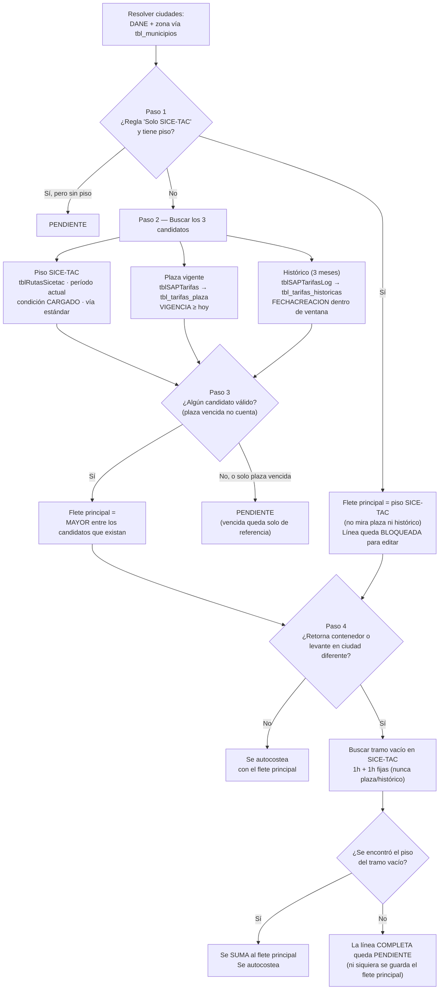

# Ejemplo spot puntual — Línea 1: Medellín → Barranquilla

_Fecha: 2026-10-21_

Sigue el diseño acordado (flujo de 7 puntos), verificado contra las tablas reales exportadas. Confirmado con `tbl_municipios`: Medellín = DANE 05001000 (zona ZTC_VABURRA), Barranquilla = DANE 08001000 (zona ZTC_BARRANQUILLA), Bogotá = DANE 11001000 (zona ZTC_BOGOTA).

## Datos de entrada

| Campo | Valor |
|---|---|
| Origen → Destino | Medellín → Barranquilla |
| Línea de negocio | Interior a Puerto |
| Vehículo / Carrocería | 2S2 / Furgón |
| Clase de viaje | Extradimensionado |
| Peso total | 15.000 kg |
| Horas cargue + descargue | 5h + 5h (las declara la línea, no se usa el default 4+4h) |
| Levante en ciudad diferente (= Aprovisionamiento) | Sí, en Bogotá |
| Retorno de contenedor | No aplica |

## Flujo seguido

**1. ¿Regla "Solo SICE-TAC"?** → **Sí.** Está en `tbl_reglas_solo_sicetac` (Medellín→Barranquilla + 2S2). Como además sí se encuentra el piso, el flete principal es **ese piso, directo** — no se mira plaza ni histórico. Saltamos al punto 4.

- Piso SICE-TAC: ruta Medellín→Barranquilla, 2S2, Furgón, "vía estándar", período de este mes. Valor base 3.924.362 + 81.396 por hora × 10 horas (las 5+5 de la línea) = **4.738.322**.

*(Puntos 2 y 3 no aplican — solo entran en juego cuando NO hay regla "Solo SICE-TAC".)*

**4. ¿Levante en ciudad diferente?** → Sí, en Bogotá. Se busca el viaje vacío Bogotá→Medellín en SICE-TAC (2S2, Furgón, vía estándar), con 1h+1h: **2.110.711**. Se encontró → se suma.

**5. ¿Se puede editar después?** → **No.** Al tener regla "Solo SICE-TAC", esta línea queda bloqueada para el Administrador de Tarifas.

**6. ¿Queda por debajo del piso?** → No, el flete es el piso mismo.

**7. Horas usadas:** cargado 5h+5h (de la línea); vacío 1h+1h (fijo — sin efecto acá porque esa ruta tiene valor por hora en cero).

## Resultado: SÍ se autocostea

| Concepto | Campo | Valor esperado |
|---|---|---|
| Flete principal | `ValorFlete` | 4.738.322 |
| Aprovisionamiento (levante Bogotá→Medellín) | `ValorAprovisionamiento` | 2.110.711 |
| Retorno de contenedor | `ValorRetornoContenedor` | No aplica |
| **Total línea** | | **6.849.033** |

Se autocostea solo, queda bloqueada para edición (por la regla "Solo SICE-TAC"), y no tiene retorno de contenedor — solo aprovisionamiento por el levante.

## Asunciones pendientes de validar

1. SICE-TAC no tiene categoría "Extradimensionado"; se usó "General" como la más cercana (no confirmado con Ismael).

---

# Ejemplo spot puntual — Línea 2: Pereira → Barranquilla

Confirmado con `tbl_municipios`: Pereira = DANE 66001000 (zona ZTC_PEREIRA).

## Datos de entrada

| Campo | Valor |
|---|---|
| Origen → Destino | Pereira → Barranquilla |
| Línea de negocio | Interior a Puerto |
| Vehículo / Carrocería | 2S3 / Estacas |
| Clase de viaje | Carga suelta |
| Peso total | 10.000 kg |
| Horas cargue + descargue | 10h + 10h (las declara la línea) |
| Levante en ciudad diferente | No |
| Retorno de contenedor | No aplica |

**Corrección:** la primera versión de este ejercicio decía que la ruta Pereira→Barranquilla no existía en `tblRutasSicetac`. Era un error mío de búsqueda (usé el código DANE de Barranquilla con el cero inicial, `08001000`, cuando en esta tabla va sin cero, `8001000`). Al corregirlo, la ruta sí aparece, y el valor que da el CSV coincide EXACTO con la captura que Sara hizo en la página oficial de SICE-TAC (Costo Hora $67.595, Costo Movilización Carga $5.762.064) — queda verificado en dos fuentes independientes.

## Flujo seguido

**1. ¿Regla "Solo SICE-TAC"?** → No. Hay reglas para Pereira→Barranquilla, pero solo con otros vehículos (2S2, "2", 3S3) — ninguna es 2S3. Sigue al punto 2.

**2. Candidatos:**
- **Piso SICE-TAC:** ruta Pereira→Barranquilla, 2S3, Estacas, vía estándar, tipología "General" (asunción para Carga suelta, igual que en línea 1). VALOR base = 5.762.064, VALORHORA = 67.595, HORASPACTADAS = 8. Con 10+10=20 horas declaradas: 5.762.064 + 67.595 × 20 = **7.113.964** — idéntico al cálculo que hizo Sara en la página oficial de SICE-TAC.
- **Plaza vigente (SAP):** 15 filas para esta zona/línea de negocio, ninguna con vehículo 2S3 — no hay candidato.
- **Plaza propia de Nexo:** 0 filas con Pereira como origen hacia Barranquilla — no hay candidato.
- **Histórico SAP (3 meses):** 3 filas encontradas, pero son de Contenedor (no Carga suelta) y están fuera de ventana (oct/nov/dic de 2025) — no cuentan.
- **Histórico propio de Nexo:** esta ruta no está creada en `tbl_rutas` — no hay candidato.
- **Mayor entre los que cuentan:** solo hay un candidato (el piso) → **Flete principal = 7.113.964.**

**3. ¿Ningún candidato, o solo una plaza vencida?** → No aplica, sí hay un candidato válido (el piso).

**4. ¿Levante en ciudad diferente?** → No. No aplica aprovisionamiento.

**5. ¿Se puede editar después?** → Sí, no tiene regla "Solo SICE-TAC".

**6. ¿Por debajo del piso?** → No aplica, el flete es el piso mismo.

**7. Horas:** 10h + 10h, declaradas en la línea.

## Resultado: SÍ se autocostea

| Concepto | Campo | Valor esperado |
|---|---|---|
| Flete principal | `ValorFlete` | 7.113.964 |
| Aprovisionamiento | `ValorAprovisionamiento` | No aplica (sin levante) |
| Retorno de contenedor | `ValorRetornoContenedor` | No aplica |
| **Total línea** | | **7.113.964** |

Verificado contra la página oficial de SICE-TAC: coincide exacto.

---

# Ejemplo spot puntual — Línea 3: Devolución de Contenedor, Buenaventura → Bucaramanga

## Datos de entrada

| Campo | Valor |
|---|---|
| Línea de negocio | Devolución de Contenedor |
| Origen / Destino | Buenaventura / Bucaramanga |
| Contenedor | CNT20.IT |
| Vehículo | 2S2 (confirmado por Sara) |
| Consolidado / Exclusivo | Consolidado = Sí, Exclusivo = No |
| Horas cargue + descargue | Default de Devolución de Contenedor: 1h + 1h |

## Flujo seguido

**1. ¿Regla "Solo SICE-TAC"?** → No. No hay ninguna regla para esta ruta con vehículo 2S2. Sigue al punto 2.

**2. Candidatos:**
- **Piso SICE-TAC:** Buenaventura→Bucaramanga, 2S2. **Corrección:** la primera versión usó la fila CONDICIONCARGA=CARGADO/"Contenedor vacío" (3.280.428) — equivocada. La correcta es CONDICIONCARGA=VACIO/"Sin carga" (ID 75039762, vía estándar): VALOR = 3.182.497, VALORHORA = 0. Verificado exacto contra la página oficial de SICE-TAC (Sara lo confirmó: $3,182,497.00). Como VALORHORA = 0, el valor no cambia con las horas (1h+1h u otras): **3.182.497**.
- **Plaza vigente (SAP):** hay 7 filas para esta ruta en `tblSAPTarifas`, pero solo 1 está vigente hoy (ID 12671, vence 2026-11-10) y esa fila tiene Consolidado=No y Exclusivo=No — no coincide con el Consolidado=Sí de la línea. Las 2 filas que sí tienen Consolidado=Sí (IDs 12758/12759) están vencidas (vencieron 2026-02-11). **Sin candidato vigente que cumpla la condición de Consolidado.**
- **Plaza propia de Nexo:** 0 filas para Buenaventura↔Bucaramanga — no hay candidato.
- **Histórico SAP (3 meses):** hay filas recientes, pero todas pertenecen a la tarifa 12671 (Consolidado=No) — ninguna de las tarifas con Consolidado=Sí (12758/12759) aparece en el histórico. Sin candidato que cumpla la condición de Consolidado.
- **Histórico propio de Nexo:** la ruta sí está creada en `tbl_rutas`, pero no tiene ninguna fila en `tbl_tarifas_historicas` — no hay candidato.
- **Mayor entre los que cuentan:** solo el piso → **Flete principal = 3.182.497.**

**3. ¿Ningún candidato, o solo una plaza vencida?** → No aplica, el piso es un candidato válido.

**4. ¿Retorna contenedor o levante?** → No aplica — esta línea ES la devolución de contenedor en sí misma, no un tramo adicional de otra línea.

**5. ¿Se puede editar después?** → Sí, no tiene regla "Solo SICE-TAC".

**6. ¿Por debajo del piso?** → No aplica, el flete es el piso mismo.

**7. Horas:** 1h + 1h (default de Devolución de Contenedor, la línea no declaró otras).

## Resultado: SÍ se autocostea

| Concepto | Campo | Valor esperado |
|---|---|---|
| Flete principal | `ValorFlete` | 3.182.497 |
| Aprovisionamiento | `ValorAprovisionamiento` | No aplica |
| Retorno de contenedor | `ValorRetornoContenedor` | No aplica (esta línea ya ES la devolución) |
| **Total línea** | | **3.182.497** |

Verificado contra la página oficial de SICE-TAC: coincide exacto.

---

# Ejemplo spot puntual — Línea 4: Nacional, Cali → Rionegro (Ant), 4 camiones recomendados

Importante: según la lógica de cubicación, **un precio por cada camión recomendado** — no un solo precio para toda la línea. Son 4 líneas independientes, cada una con su propio flete.

_Versión invertida del ejercicio original (que era Rionegro→Cali, retorno a Rionegro) para ver cómo se comporta el sistema al cambiar el sentido de la ruta._

## Datos de entrada (comunes a los 4)

| Campo | Valor |
|---|---|
| Línea de negocio | Nacional |
| Origen → Destino | Cali → Rionegro (Antioquia) |
| Clase de viaje | Carga suelta |
| Carrocería | Furgón |
| Horas | Default 4h+4h (no declaradas) |
| Retorna Contenedor | Sí, en los 4 — devolución en Cali (mismo origen) |

| # | Vehículo | Peso | Observación |
|---|---|---|---|
| 1 | Minimula 2S2 | 18.000 kg | 100% peso |
| 2 | Tractomula 3S3 | 30.000 kg | 100% peso |
| 3 | Tractomula 3S3 | 30.000 kg | Idéntico al #2 |
| 4 | Tractomula 3S3 | 22.000 kg | 73% peso, bajo llenado |

## Flujo seguido (aplica igual a los 4; solo cambia el vehículo)

**1. ¿Regla "Solo SICE-TAC"?** → No, ni para 2S2 ni para 3S3 en esta ruta (tampoco en este sentido).

**2. Candidatos (piso / plaza / histórico):**
- **Piso SICE-TAC** (vía estándar, Furgón, tipología "General" para Carga suelta):
  - 2S2: VALOR 3.254.497 + 81.396×8h = **3.905.665**
  - 3S3: VALOR 4.687.597 + 107.530×8h = **5.547.837**
- **Plaza vigente (SAP):** hay filas para esta ruta+Furgón, pero **las del sentido Cali→Rionegro con vehículo 2S2/3S3 están vencidas** (vigencia 2026-07-11, ya pasada). Las únicas vigentes en este sentido son para vehículos livianos (2L2/"2", que no aplican a estas líneas). Sin candidato vigente.
- **Plaza propia de Nexo:** 0 filas para Cali↔Rionegro — sin candidato.
- **Histórico SAP (3 meses):** de las 111 filas históricas de esta ruta, ninguna del sentido Cali→Rionegro con Furgón+2S2 o Furgón+3S3 cae dentro de los últimos 3 meses (las más recientes de esos vehículos son de agosto 2025) — sin candidato.
- **Histórico propio de Nexo:** la ruta ni siquiera está creada en `tbl_rutas` — sin candidato.
- **Mayor entre los que cuentan:** solo el piso → **Flete principal = el piso de cada vehículo.**

**3-6.** No aplican excepciones; todas quedan autocosteadas y editables después.

**4. Retorna Contenedor → Cali:** piso SICE-TAC viaje vacío Rionegro→Cali, Furgón, vía estándar, 1h+1h (sin efecto, VALORHORA=0):
- 2S2: **2.547.021**
- 3S3: **3.689.517**

## Resultado: los 4 SÍ se autocostean

| # | Vehículo | `ValorFlete` | `ValorRetornoContenedor` | Total |
|---|---|---|---|---|
| 1 | Minimula 2S2 | 3.905.665 | 2.547.021 | **6.452.686** |
| 2 | Tractomula 3S3 (30.000kg) | 5.547.837 | 3.689.517 | **9.237.354** |
| 3 | Tractomula 3S3 (30.000kg) | 5.547.837 | 3.689.517 | **9.237.354** |
| 4 | Tractomula 3S3 (22.000kg, bajo llenado) | 5.547.837 | 3.689.517 | **9.237.354** |

El piso SICE-TAC no varía por el peso real cargado (solo por ruta+vehículo+unidad de transporte), así que los camiones #2, #3 y #4 dan el mismo valor aunque lleven distinto peso.

**Comparado con el sentido original** (Rionegro→Cali, retorno a Rionegro: 6.451.447 y 9.234.398), la diferencia es mínima (entre 1.200 y 3.000 pesos). **No es simétrico exacto**: SICE-TAC calcula cada sentido de la ruta de forma independiente (horas de recorrido y vía pueden variar levemente entre ida y vuelta), así que invertir origen/destino no da matemáticamente el mismo número, aunque sea muy parecido.

---

# Ejemplo spot puntual — Línea 5: Nacional, Cartagena → Medellín (con los 3 candidatos reales)

Elegida porque es una de las rutas donde **los 3 candidatos existen a la vez** (piso SICE-TAC, plaza vigente e histórico en ventana), para ver la regla del mayor compitiendo de verdad entre las tres fuentes.

## Datos de entrada

| Campo | Valor |
|---|---|
| Línea de negocio | Nacional |
| Origen → Destino | Cartagena → Medellín |
| Vehículo / Carrocería | 3S3 / Furgón |
| Clase de viaje | Carga suelta (asunción, igual convención que líneas 2 y 4) |
| Horas | Default 4h+4h (no declaradas) |
| Levante en ciudad diferente (= Aprovisionamiento) | Sí, en Cali |

## Flujo seguido

**1. ¿Regla "Solo SICE-TAC"?** → No, no hay regla para esta ruta+vehículo. Sigue al punto 2.

**2. Candidatos:**
- **Piso SICE-TAC:** vía estándar, tipología "General". VALOR base 5.433.590, VALORHORA 107.530, HORASPACTADAS 8. Con el default 4+4=8h (igual a las pactadas): **6.293.830**.
- **Plaza vigente (SAP):** vehículo 3S3, carrocería Furgón, vigencia 2026-11-12 (vigente): **5.900.000**.
- **Histórico SAP (3 meses, por `FECHACREACION`):** mismo vehículo/carrocería, creado 2026-09-24 (dentro de ventana): **5.750.000**.
- **Mayor entre los tres:** max(6.293.830, 5.900.000, 5.750.000) → **gana el piso SICE-TAC. Flete principal = 6.293.830.**

**3. ¿Ningún candidato, o solo una plaza vencida?** → No aplica, hay 3 candidatos válidos.

**4. ¿Levante en ciudad diferente?** → Sí, en Cali. Viaje vacío Cali→Cartagena, 3S3, Furgón, vía estándar, 1h+1h (VALORHORA=0, sin efecto): **7.361.983**. Se encontró → se suma.

**5. ¿Se puede editar después?** → Sí, no tiene regla "Solo SICE-TAC".

**6. ¿Por debajo del piso?** → No aplica, el piso fue el que ganó.

**7. Horas:** cargado 4h+4h (default); vacío 1h+1h (fijo, sin efecto por VALORHORA=0).

## Resultado: SÍ se autocostea

| Concepto | Campo | Valor esperado |
|---|---|---|
| Flete principal | `ValorFlete` | 6.293.830 |
| Aprovisionamiento (levante Cali→Cartagena) | `ValorAprovisionamiento` | 7.361.983 |
| Retorno de contenedor | `ValorRetornoContenedor` | No aplica |
| **Total línea** | | **13.655.813** |

Aquí el piso ganó sobre plaza e histórico — a diferencia del ejemplo de Medellín→Cúcuta, donde ganaba la plaza.

---

# Ejemplo spot puntual — Línea 6: Nacional, Bogotá → Villavicencio (con los 3 candidatos reales)

## Datos de entrada

| Campo | Valor |
|---|---|
| Línea de negocio | Nacional |
| Origen → Destino | Bogotá → Villavicencio |
| Vehículo / Carrocería | 2S2 / Furgón |
| Clase de viaje | Carga suelta (asunción) |
| Horas | Default 4h+4h (no declaradas) |
| Levante en ciudad diferente (= Aprovisionamiento) | Sí, en Cali |

## Flujo seguido

**1. ¿Regla "Solo SICE-TAC"?** → No, no hay regla para esta ruta+vehículo. Sigue al punto 2.

**2. Candidatos:**
- **Piso SICE-TAC:** vía estándar, tipología "General". VALOR base 1.029.747, VALORHORA 81.396, HORASPACTADAS 8. Con el default 4+4=8h (igual a las pactadas): **1.680.915**.
- **Plaza vigente (SAP):** vehículo 2S2, carrocería Furgón, vigencia 2026-11-10 (vigente): **2.800.000**.
- **Histórico SAP (3 meses, por `FECHACREACION`):** mismo vehículo/carrocería, creado 2026-09-21 (dentro de ventana): **2.900.000**.
- **Mayor entre los tres:** max(1.680.915, 2.800.000, 2.900.000) → **gana el histórico. Flete principal = 2.900.000.**

**3. ¿Ningún candidato, o solo una plaza vencida?** → No aplica, hay 3 candidatos válidos.

**4. ¿Levante en ciudad diferente?** → Sí, en Cali. Viaje vacío Cali→Bogotá, 2S2, Furgón, vía estándar, 1h+1h (VALORHORA=0, sin efecto): **2.134.250**. Se encontró → se suma.

**5. ¿Se puede editar después?** → Sí, no tiene regla "Solo SICE-TAC".

**6. ¿Por debajo del piso?** → No, 2.900.000 > 1.680.915 (el piso), cumple la regla.

**7. Horas:** cargado 4h+4h (default); vacío 1h+1h (fijo, sin efecto por VALORHORA=0).

## Resultado: SÍ se autocostea

| Concepto | Campo | Valor esperado |
|---|---|---|
| Flete principal | `ValorFlete` | 2.900.000 |
| Aprovisionamiento (levante Cali→Bogotá) | `ValorAprovisionamiento` | 2.134.250 |
| Retorno de contenedor | `ValorRetornoContenedor` | No aplica |
| **Total línea** | | **5.034.250** |

Este es el primer ejemplo de la serie donde **gana el histórico**, no el piso ni la plaza — muestra la regla del mayor funcionando con las 3 fuentes compitiendo de verdad.

---

# Ejemplo spot puntual — Línea 7: Nacional, Medellín → Abejorral (SOLO plaza, y está vencida)

Confirmado contra los datos reales: Medellín↔Abejorral tiene **0 filas en SICE-TAC** (cualquier período/vehículo), **0 filas en plaza propia de Nexo**, y la ruta ni siquiera está creada en `tbl_rutas` (0 histórico propio). El único dato que existe en cualquier fuente es una plaza SAP, y está vencida.

## Datos de entrada

| Campo | Valor |
|---|---|
| Línea de negocio | Nacional |
| Origen → Destino | Medellín → Abejorral (Antioquia) |
| Vehículo / Carrocería | 2S2 / Planchón |
| Clase de viaje | Carga suelta (asunción) |
| Horas | Default 4h+4h |
| Levante en ciudad diferente | No |

## Flujo seguido

**1. ¿Regla "Solo SICE-TAC"?** → No.

**2. Candidatos:**
- **Piso SICE-TAC:** 0 filas para esta ruta en `tblRutasSicetac`, para ningún vehículo. No existe.
- **Plaza vigente (SAP):** la única fila para esta ruta+vehículo tiene vigencia 2024-10-31 — **ya venció** (hoy es 2026-10-21). No cuenta como vigente.
- **Plaza propia de Nexo:** 0 filas.
- **Histórico SAP (3 meses, por FECHACREACION):** nada dentro de ventana para esta ruta+vehículo.
- **Histórico propio de Nexo:** la ruta no existe en `tbl_rutas`.
- **No hay ningún candidato válido** — lo único que existe es la plaza vencida, que solo sirve como referencia.

**3. ¿Ningún candidato, o solo una plaza vencida?** → **Sí, exactamente este caso.** La línea queda **pendiente**.

## Resultado: NO se autocostea

| Concepto | Campo | Valor esperado |
|---|---|---|
| Flete principal | `ValorFlete` | Pendiente |
| Referencia (no utilizable) | — | Plaza vencida: 1.900.000 (venció 2024-10-31) |

Queda 100% para el Administrador de Tarifas, con la plaza vencida como único dato de referencia — no se autocostea con ella.

---

# Ejemplo spot puntual — Línea 8: Nacional, Bogotá → Coyaima (SOLO plaza, y está vigente)

Confirmado: Bogotá↔Coyaima tiene **0 filas en SICE-TAC**, **0 filas en plaza propia**, ruta no creada en `tbl_rutas`. Pero a diferencia de línea 7, aquí la plaza SAP **sí está vigente**.

## Datos de entrada

| Campo | Valor |
|---|---|
| Línea de negocio | Nacional |
| Origen → Destino | Bogotá → Coyaima (Tolima) |
| Vehículo / Carrocería | 2S2 / Estacas |
| Clase de viaje | Carga suelta (asunción) |
| Horas | Default 4h+4h |
| Levante en ciudad diferente | No |

## Flujo seguido

**1. ¿Regla "Solo SICE-TAC"?** → No.

**2. Candidatos:**
- **Piso SICE-TAC:** 0 filas — no existe.
- **Plaza vigente (SAP):** vigencia 2026-11-10 (vigente hoy): **3.100.000**.
- **Plaza propia de Nexo:** 0 filas.
- **Histórico SAP (3 meses):** nada dentro de ventana.
- **Histórico propio de Nexo:** ruta no creada.
- **Mayor entre los que cuentan:** solo la plaza → **Flete principal = 3.100.000** (no hace falta que exista el piso para que la plaza gane sola, por diseño).

**3. ¿Ningún candidato, o solo una plaza vencida?** → No aplica, la plaza SÍ es un candidato válido (vigente).

**4-6.** No aplican excepciones.

## Resultado: SÍ se autocostea

| Concepto | Campo | Valor esperado |
|---|---|---|
| Flete principal | `ValorFlete` | 3.100.000 |
| Aprovisionamiento | `ValorAprovisionamiento` | No aplica |
| Retorno de contenedor | `ValorRetornoContenedor` | No aplica |
| **Total línea** | | **3.100.000** |

Este caso muestra la regla del punto 2 en su forma más pura: sin piso, la plaza vigente gana sola y la línea se autocostea igual.

---

# Ejemplo spot puntual — Línea 9: Medellín → Cúcuta, con levante en Abejorral (flete válido, pero el levante no tiene piso)

Reutiliza la línea de Medellín→Cúcuta (2S2, Estacas, Nacional) que ya tenía los 3 candidatos reales (piso 3.869.916, plaza 5.600.000, histórico 4.075.000 — ganaba la plaza). Le agrego un levante en Abejorral: como el vehículo no está en Medellín sino en Abejorral, hay que traerlo vacío de Abejorral a Medellín antes de cargar. Pero Abejorral↔Medellín tiene **0 filas en SICE-TAC**, para cualquier vehículo — el mismo hallazgo que ya habíamos visto con Armenia (Antioquia).

## Datos de entrada

| Campo | Valor |
|---|---|
| Línea de negocio | Nacional |
| Origen → Destino | Medellín → Cúcuta |
| Vehículo / Carrocería | 2S2 / Estacas |
| Levante en ciudad diferente | Sí, en Abejorral (Antioquia) |

## Flujo seguido

**1-3.** Igual que el ejemplo de los 3 candidatos: gana la plaza, **Flete principal = 5.600.000** (candidato válido, no hay excepción).

**4. ¿Levante en ciudad diferente?** → Sí, en Abejorral. Se busca el viaje vacío Abejorral→Medellín en SICE-TAC: **0 filas, para ningún vehículo.** No se encuentra ningún piso para el tramo vacío.

Por la regla del punto 4: si el tramo vacío no se encuentra, **la línea COMPLETA queda pendiente** — no se guarda nada, ni siquiera el flete principal de 5.600.000 que sí se había calculado correctamente.

## Resultado: NO se autocostea (a pesar de tener flete principal válido)

| Concepto | Campo | Valor esperado |
|---|---|---|
| Flete principal (calculado, pero NO se guarda) | `ValorFlete` | 5.600.000 (no se aplica) |
| Aprovisionamiento | `ValorAprovisionamiento` | No encontrado — 0 filas en SICE-TAC para Abejorral↔Medellín |
| **Resultado final** | | **Pendiente, línea completa** |

Este es el ejemplo más estricto del flujo: tener un flete principal perfectamente válido no salva la línea si el tramo vacío exigido no se puede calcular.

---

# Resumen — flujo general seguido en este ejercicio

Este es el procedimiento que se repitió, igual, para las 9 líneas de este documento — no el resultado de cada una (eso ya está en su propia sección), sino el método con el que se llegó a cada resultado:

**1. Resolver ciudades reales.** Antes de buscar nada, se confirmó el código DANE y la zona de tarificación de cada ciudad contra `tbl_municipios` (nunca de memoria) — ahí salió el hallazgo de que `tblRutasSicetac` guarda el DANE **sin el cero inicial** cuando el departamento es de un solo dígito, mientras que `tbl_municipios` y `tbl_reglas_solo_sicetac` sí lo conservan. Un solo error de esto (línea 2, Pereira→Barranquilla) hizo que pareciera que la ruta no existía, cuando sí existía.

**2. Paso 1 — ¿Regla "Solo SICE-TAC"?** Se revisó `tbl_reglas_solo_sicetac` por ruta+vehículo exactos. Cuando aplica (línea 1), el piso gana directo y ni se consulta plaza ni histórico, y la línea queda bloqueada para edición.

**3. Paso 2 — Buscar los 3 candidatos, cada uno en sus propias tablas:**
   - **Piso SICE-TAC:** `tblRutasSicetac`, filtrando período del mes actual, condición CARGADO, y quedándose solo con la fila marcada `VIAESTANDAR='SI'` cuando hay varias rutas alternas para la misma combinación.
   - **Plaza vigente:** primero `tblSAPTarifas` (SAP), y si no hay nada ahí, `tbl_tarifas_plaza` (propia de Nexo). "Vigente" se decide comparando `VIGENCIA` (fecha de vencimiento, confirmado por Sara) contra hoy — nunca al revés.
   - **Histórico (ventana de 3 meses):** primero `tblSAPTarifasLog`, y si no hay nada, `tbl_tarifas_historicas` (propia, resuelta por `tbl_rutas`+`tbl_configuraciones_vehiculo`). La ventana se filtra por **`FECHACREACION`** del registro, no por su `VIGENCIA` — esto se corrigió a mitad del ejercicio después de leer el código real (`clsPropuestaTarifaAdapter.cs:732`).
   - Se toma el **mayor** entre los candidatos que sí existan — no hace falta que existan los tres.

**4. Paso 3 — ¿Nada, o solo una plaza vencida?** Si no queda ningún candidato válido (o el único que apareció es una plaza ya vencida), la línea queda pendiente ahí mismo, sin seguir al tramo vacío.

**5. Paso 4 — Tramo vacío (aprovisionamiento o retorno de contenedor), si la línea lo marca.** Siempre se busca en SICE-TAC (nunca en plaza/histórico), con 1h+1h fijas. Si se encuentra, se suma al flete principal. Si no se encuentra, la línea **completa** queda pendiente, aunque el flete principal ya estuviera calculado (línea 9).

**6. Horas:** las que declare la línea mandan; si no declara, el default es 4h+4h en el tramo cargado (1h+1h si es Devolución de Contenedor), y el tramo vacío siempre es 1h+1h sin importar lo anterior.

**Verificaciones de camino, no del flujo en sí, pero igual de importantes:** se confirmó que el DANE con cero inicial recortado solo pasa en `tblRutasSicetac` (no en las tablas de plaza); que el vehículo pedido, en las 3 fuentes (piso, plaza SAP, plaza propia), puede relajarse silenciosamente a "cualquier vehículo" si el exacto no deja filas — una búsqueda más tolerante de lo que parece a simple vista, y que conviene tener presente antes de concluir "sin candidato" en cualquier fuente.

## Figura del flujo

